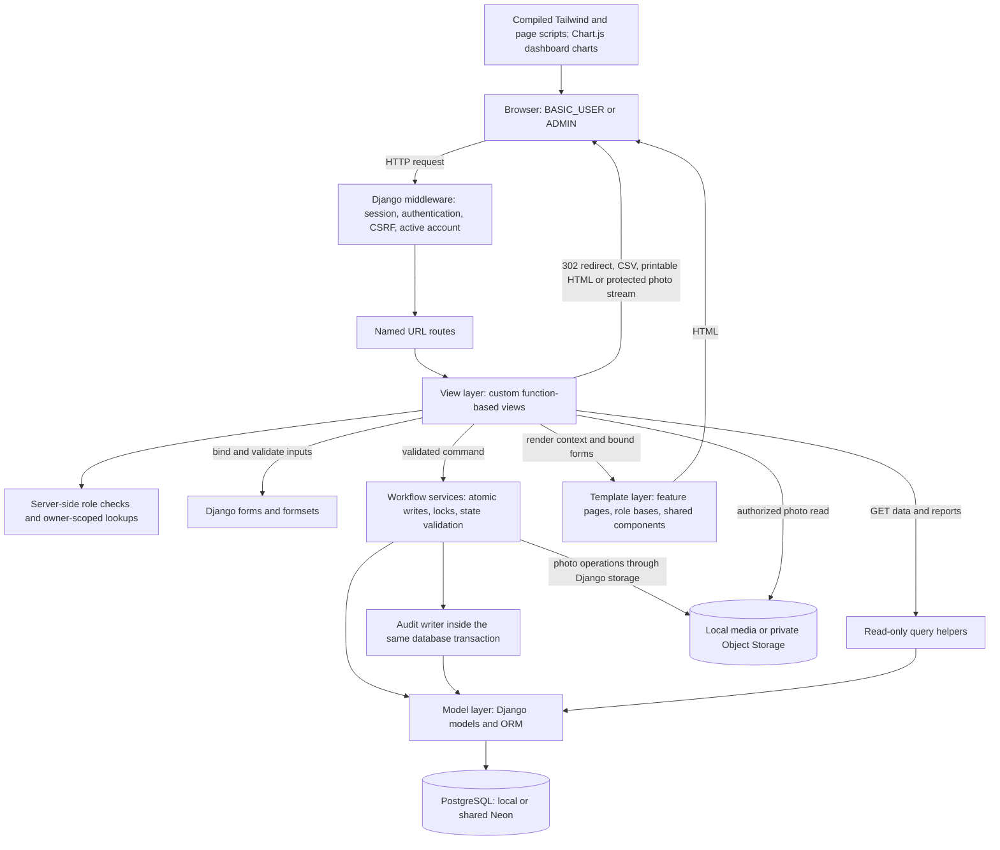
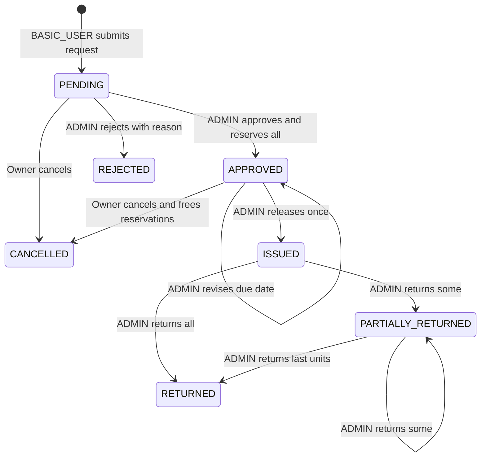
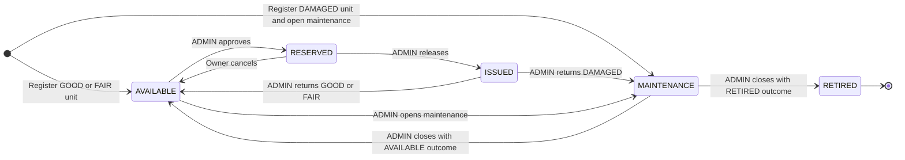

# System Architecture Design

## Status and implemented stack

This architecture describes the implemented application through T24. The [backlog](tasks.md#verified-task-evidence) owns acceptance/integration evidence. Behavioral authority is [SRS.md](SRS.md); persistence is in [db_design.md](db_design.md) and actual models/migrations. [Coding standards](coding-standards.md) define MTV boundaries and review rules. The MTV and workflow references below were reconciled against main `e2c3f61` (PR #59, including T24 PR #58) on October 22, 2026 for Jerome's authorized T25 documentation preparation. They are the drawing basis for Kenneth and Ellyssa; editable tool sources/exports and team review remain pending. Use [the T25 consumer checklist](../DEV.md#t25-readiness-and-consumer-handoff).

The application is one server-rendered Django monolith using Python 3.13, Django 5.2 LTS, PostgreSQL and Psycopg 3. Exact pins belong in [requirements.txt](../requirements.txt). Local regression tests use PostgreSQL 17; normal team configuration selects shared Neon PostgreSQL and private Object Storage, while standalone evaluation uses local PostgreSQL/media. T24 used a separate PostgreSQL 18.6 recovery lab; see [measured configurations and limits](operational-verification.md). These are configurations of the same application.

HTML/CSS and minimal JavaScript serve both roles. The user selected Tailwind CSS for styling. Ordinary Django forms and links handle the current HTTP interactions; no browser HTTP library is installed. The local npm build, shared HTML shell, and role navigation layouts are implemented. UI-09 supplies shared semantic roles/components with the supplied minimal dashboard palette and desktop sidebar, integrated through PR #39 at `a35e0f1` (source `043822e`) and preserved in main `866eb7e`. Fixed colors live in the shared stylesheet with a dependency-free contrast check; native Django forms, authorization and workflow services remain unchanged. [The coding guide](coding-standards.md#shared-m3-roles-and-components-ui-09) owns component usage; [DEV.md](../DEV.md#frontend-assets-tailwind-and-page-scripts) owns build commands. The former role-home and feature placeholders have been replaced by implemented views listed in [the HTTP contract](api_spec.md#status-and-interface-choice); future work retains its backlog gates. T18 is integrated through PR #45 at `26b1ee5`; UI-11/UI-12 are integrated through PR #48 at `9d67fab`; UI-11 uses Chart.js 4.5.1 for the two required charts, bundled through the existing esbuild command. Django owns aggregation and JSON-safe embedding; accessible disclosure tables remain available without JavaScript. UI-12 adds an active-ADMIN template context processor for the Pending-request badge, using the same read-only count helper as the dashboard. This library renders charts and does not generate administration pages. There are no required external APIs, background workers, message brokers, or separate frontend services.

## Required patterns and selected libraries

The [course brief](Project-Requirements.txt), CO2 and Parts 5–6, requires the following evidence and behavior. A service layer is our implementation choice within its allowed reusable-logic approaches; the brief does not mandate a named GoF pattern.

| Requirement | Project application |
| --- | --- |
| Django MTV and MTV/database/workflow diagrams | Models/ORM persist data, function-based views orchestrate HTTP, and server-rendered templates present pages; the diagrams in the design documents describe those boundaries |
| Reusable business logic | The brief allows functions, services, or model methods. This project uses explicit workflow service functions and read-only query helpers, following the coding guide |
| Template inheritance and reusable components | `templates/base.html` supplies the document/assets; `components/workspace.html` supplies the sticky header, messages, and footer; `operations/manage/base.html` and `accounts/portal/base.html` supply role navigation. Feature pages fill `workspace_content`; form/table fragments can be extracted when needed |
| Compare two suitable system options and justify one | The comparison below is design evidence, rather than a software design pattern; later course evidence must evaluate the implemented system and actual user needs |

Part 5 permits third-party packages when declared and justified, and forbids generating the required custom administration side. Tailwind is not named by the brief; using it under that general rule is our interpretation. It does not generate views, forms, admin pages, or authorization.

The [README dependency disclosure](../README.md#third-party-packages-and-assets) owns package purposes, tradeoffs, runtime/build roles, and license declarations. The [complete inventory](third-party-dependencies.md) lists locked indirect/optional packages as well. Keep those sources current instead of duplicating a second justification table here.

Exact package pins and transitive dependencies are in [package.json](../package.json) and [package-lock.json](../package-lock.json), separate from Python requirements. Build/watch commands and usage belong in [DEV.md](../DEV.md#frontend-assets-tailwind-and-page-scripts). Source fonts retain their OFL notices; include the Chart.js/color MIT notices from `static/licenses/chartjs-MIT.txt` with runnable artifacts. Follow the [Tailwind CLI](https://tailwindcss.com/docs/installation/tailwind-cli) and [esbuild](https://esbuild.github.io/getting-started/) documentation.

The canonical [coding guide](coding-standards.md#http-endpoint-design) owns endpoint design, native browser interaction boundaries, Tailwind styling/naming, and formatter responsibilities. These conventions retain the existing HTML/form/session interface; no new REST or JSON endpoint is implemented by documenting them.

## Options comparison

| Option | Benefits | Limitations | Recommendation |
| --- | --- | --- | --- |
| Django monolith with SQLite | Simple local demonstration and few infrastructure dependencies | Django's `select_for_update()` does not lock SQLite rows; this design's concurrency proof cannot be assumed to work there | Allowed by the brief, but not the baseline for this locking design |
| Django monolith with PostgreSQL | Row locking and conditional uniqueness support fit per-unit reservations; shared transactional storage | Requires a database service and documented database configuration | Implemented baseline; T14 PostgreSQL competing-approval proof integrated through PR #37 |

A separate SPA/backend would add endpoint and client-state work without meeting an additional required capability. Keep Django templates and forms. Django documents row locking, SQLite limitations, and the need for `TransactionTestCase` in its [QuerySet reference](https://docs.djangoproject.com/en/5.2/ref/models/querysets/#select-for-update).

The [T26 evidence comparison](user-needs-evidence-guide.md#compare-two-suitable-options) evaluates PostgreSQL against an alternative MySQL/InnoDB design, including the adaptations needed for conditional uniqueness and the recommendation to retain PostgreSQL. It distinguishes researched feasibility from tested application support; this architecture retains the implemented PostgreSQL baseline.

## Model-template-view structure

Views enforce HTTP/access rules and orchestrate forms, services, and rendering. Forms validate submitted shape and field-level values. Services own complete business transitions and database writes. Query functions own list, availability, dashboard, and reporting reads. Models/migrations enforce relational and row-level constraints. Templates render allowed data and named URLs; they do not enforce authorization.

The browser receives HTML, printable HTML, and CSV exports. Small JavaScript enhancements do not replace server validation. Authentication uses Django sessions and CSRF protection.

### MTV drawing guide

For Lucidchart, keep the Model, Template and View boundaries visible; forms, services and queries support these layers rather than replacing MTV. Arrows above show calls/data delivery, not a strict timeline: a view checks access before protected work, validates a bound form, and calls a service only when valid. Public login/registration use their explicit authentication rules; role and owner checks apply to protected routes. Services recheck their authoritative permissions/state. Templates cannot authorize a request.

| Box or connection              | Implemented source to follow                                                                                                                                                                                                                                                                                                                                                 |
| ------------------------------ | ---------------------------------------------------------------------------------------------------------------------------------------------------------------------------------------------------------------------------------------------------------------------------------------------------------------------------------------------------------------------------- |
| Middleware and URL dispatch    | [settings](../config/settings.py), [root URLs](../config/urls.py), [account routes](../accounts/urls.py), [portal routes](../accounts/portal_urls.py), [inventory routes](../inventory/manage_urls.py), [borrowing routes](../borrowing/manage_urls.py), [operations routes](../operations/urls.py)                                                                          |
| Active/role/owner boundary     | [access helpers](../accounts/access.py), [inactive-session middleware](../accounts/middleware.py); portal record lookups use signed-in ownership                                                                                                                                                                                                                             |
| View/forms/service sequence    | [request views](../borrowing/views.py), [forms](../borrowing/forms.py), [request services](../borrowing/services.py); [release views](../borrowing/release_views.py)/[services](../borrowing/release_services.py) and [return views](../borrowing/return_views.py)/[forms](../borrowing/return_forms.py)/[services](../borrowing/return_services.py)                         |
| Model and transaction boundary | The four apps' models/migrations in [database design](db_design.md); [locking](../operations/locking.py), [audit writer](../operations/audit.py). Submission creates no audit event in the current implementation; show audit writes for actions that actually call the writer                                                                                               |
| Read path                      | [inventory queries](../inventory/queries.py), [borrowing queries](../borrowing/queries.py), [operations queries](../operations/queries.py), [report views](../operations/workspace_views.py)                                                                                                                                                                                 |
| Template inheritance           | [base.html](../templates/base.html) is extended by [workspace.html](../templates/components/workspace.html), then [management base](../templates/operations/manage/base.html) or [portal base](../templates/accounts/portal/base.html), then feature pages. [Printable slip](../templates/borrowing/manage/loan_slip.html) extends the document base directly                |
| Storage and assets             | [storage selection](../config/media_storage.py), [photo service](../inventory/photo_services.py), [admin stream](../inventory/photo_views.py), [portal stream](../inventory/portal_views.py), [build scripts](../package.json), [startup asset checks](../operations/checks.py). Image bytes live outside PostgreSQL; storage changes are not part of its atomic transaction |

Draw no generated Django admin, separate REST API, third role, background worker or direct browser-to-database/bucket connection. Chart.js renders server-provided aggregates. Photo reads pass through protected Django views. PostgreSQL transaction rollback does not roll back object storage; the photo services use cleanup and commit callbacks.

**Editable MTV source/export:** pending Kenneth/Ellyssa conversion and team review. Add the real editable document link and readable export here when available; the Mermaid block is the current reference.

## Implemented modules and ownership

For the detailed existing/planned directory tree and page placement examples, see [Project Folder Architecture](project-folder-architecture.md). The coding guide remains authoritative for each file's responsibilities.

The config directory, four feature apps, shared `static/`, and role/feature templates below exist.

| Module | Responsibility | Primary owner |
| --- | --- | --- |
| `config/` | Settings, root URL configuration, application entry points | Jerome with Alex for security settings |
| `accounts/` | Custom auth user/profile, login, role/active checks, account management, registration/profile | Alex; Ellyssa owns portal-facing registration/profile pages |
| `inventory/` | Categories, items, units, maintenance, availability queries | Kenneth delivered catalog/units/maintenance baseline; Jerome now owns T16 maintenance |
| `borrowing/` | Requests/items, allocations, loans/loan units, returns, workflow services | Jerome defines shared models and owns T15 release; Ralph owns submission/tracking and T17 returns; Margareth delivered T13 approval |
| `operations/` | Audit logs, settings, dashboard/report queries, exports | Jerome for audit/settings; Alex for dashboard/reports |
| `templates/` | Shared document/role layouts, navigation/messages and implemented T05–T13/T16 pages plus integrated T15 release/date/loan/slip pages, T17 returns, T18 dashboard and T19 loan/overdue report pages; T20 borrower home and shared fields/statuses/pagination/empty states | Feature owners; Ralph owns T20 integration; Ellyssa supports validation/documentation/manual testing |
| `static/` | Source fonts/images/CSS/JavaScript and ignored generated `build/` assets; discovered through STATICFILES_DIRS | Feature owners |

Current task/support assignments follow [the backlog ownership decision](tasks.md#current-ownership-and-support-responsibilities). Jerome authorized preparation of these drawing references; Kenneth/Ellyssa's editable-tool conversion and review remain to be recorded. Original implementation credit is preserved.

Each Django app keeps models, forms, function-based views, URLs, service/query functions, migrations, and tests close to its feature. Split further only when actual file size or responsibility warrants it. Avoid a generic CRUD framework or unnecessary repository abstraction over Django ORM.

Define the custom user model before the first migration. All foreign keys reference the configured authentication model. Roles come from one field, never from Django admin flags or separate authentication systems. No `admin.site.urls`, built-in admin pages, or admin-generation packages.

## Transaction boundaries and lock order

Every state transition re-reads authoritative database state inside `transaction.atomic()`. Do not rely on availability previously rendered in a page.

For borrowing operations, use the shared order: borrower User row, BorrowRequest row, existing Loan row where applicable, Category rows in ascending ID order, CatalogItem rows in ascending ID order where catalog eligibility is checked, then EquipmentUnit rows in ascending ID order. New request submission also locks the singleton SystemSetting row after the borrower and before catalog records to capture consistent limits. Lock and re-read related allocation/loan-unit records as needed after their parent and unit locks. Do not acquire the same shared locks in a reverse order in another service. Catalog archival/restoration uses the same parent-before-child category/item locks; account deactivation uses the User lock, so a concurrent transaction cannot pass a stale active-account check.

1. **Submit:** validate the entire formset, lock/recheck the borrower, lock/capture current settings, then lock/recheck eligible catalog records and create the request/items atomically. No allocations are created.
2. **Approve:** lock borrower, request, eligible category/item records in a consistent parent-before-child order, and candidate units. Recheck Pending state and availability after acquiring locks. Select exactly the requested quantity per item. Insert allocations, set unit statuses and decision fields, and append audit data in one transaction. Any shortage rolls everything back.
3. **Cancel:** lock the owner, request, and reserved units. Recheck owner/state, end reservations, set units Available, set Cancelled, and append audit data together.
4. **Release:** lock borrower, approved request, and assigned units. Validate date and complete allocation sets. Create the one Loan and all LoanUnits, record allocation release timestamps, set units Issued/request Issued, and audit. Allocations remain active until return. T15 implements this in `borrowing/release_services.py`; `borrowing/reservations.py` shares complete reservation checks/locks with cancellation without changing their order. T16 maintenance remains separate.
5. **Return:** lock borrower, request, loan, and returning units. Check membership and absent return records; create returns, end allocations, and update unit/request/loan states. Damaged returns open maintenance within this same transaction. Close the loan only if no outstanding unit remains. T17 implements this in `borrowing/return_services.py`; `return_forms.py` validates selected rows and `return_views.py` handles the protected native form. Returns remain possible for an inactive borrower and archived catalog records so existing issued equipment can be recovered. Only the receiving administrator must remain active.
6. **Maintenance:** standalone administrator actions lock/recheck the actor, then lock the unit before its maintenance record. Re-read authoritative state and record opening/repair/retirement plus audit atomically. `open_maintenance` is manual-only and always requires Available state; it accepts no return identifier. T17 owns damaged-return maintenance inside the complete return transaction and must not call this manual opener as a status-check bypass. Maintenance must not subsequently acquire borrowing-parent locks.
7. **Settings/account/catalog changes:** validate allowlisted fields and record the business change and audit together. Request submission reads a single consistent settings row; settings edits do not rewrite existing requests.

When approval needs both category and catalog locks, lock categories in ascending ID order before catalog items; submission uses the same order. Archiving a category checks its child records under that order. This refines the general lock sequence above. Implement one shared lock convention and verify it in review rather than adding independent locking code per view.

A partial unique constraint on `UnitAllocation.unit_id` while `ended_at IS NULL` protects exclusivity in addition to locks. A unique Loan request reference and unique ReturnRecord loan-unit reference prevent duplicate issue/return. Cross-table invariants remain service responsibilities; see [db_design.md](db_design.md).

Never silently skip an unavailable requested quantity or convert an operational conflict into success. Translate recognized validation/state conflicts into explicit errors. Unexpected database errors remain failures. Retrying a mutating transaction after an ambiguous commit is unsafe without a verified idempotency strategy and is not part of this baseline.

## Workflow view

The nodes above are exactly the persisted `RequestStatus` values. REJECTED, CANCELLED and RETURNED are terminal, with no outgoing transitions. The APPROVED self-loop changes a date, not status; it preserves the original desired date and uses submission-time limits. The PARTIALLY_RETURNED self-loop matters for three or more issued units. A transition represents a successful service commit; invalid input/state or insufficient stock leaves no partial change. Approval/rejection both require a reason. Submission creates no allocation and does not guarantee stock; approval locks and rechecks current units.

### Physical-unit and maintenance workflow

`MAINTENANCE` above is an EquipmentUnit status. Each MaintenanceRecord has its own `OPEN` then `CLOSED` lifecycle: registration damage, manual opening, or a damaged return creates OPEN; closure sets actor/time/action and AVAILABLE or RETIRED outcome. One open record per unit is allowed. Manual maintenance starts only from AVAILABLE; damaged returns create linked maintenance inside the return service. RETIRED units have no reactivation path. Generic metadata editing cannot change condition/status.

### Workflow drawing guide

Use separate request and physical-unit state pages so a Returned request is not confused with an Available unit. Add BASIC_USER/ADMIN actor labels or swimlanes, retaining the exact uppercase stored states above. Keep the following transaction and derived-state notes beside the diagrams.

| Action/annotation                      | Source and effects that the drawing must preserve                                                                                                                                                                                                                                                                                                                                                                                     |
| -------------------------------------- | ------------------------------------------------------------------------------------------------------------------------------------------------------------------------------------------------------------------------------------------------------------------------------------------------------------------------------------------------------------------------------------------------------------------------------------- |
| Submit, approve, reject, cancel        | [request services](../borrowing/services.py): 1-3 distinct item lines and snapshotted limits; reserve all or none on approval; PENDING cancellation has no inventory effect; APPROVED cancellation ends every reservation. A decision/cancellation appends its audit in the same transaction                                                                                                                                          |
| Revise due date and release            | [release services](../borrowing/release_services.py), [reservation validation](../borrowing/reservations.py): revision only in APPROVED without a loan; release requires an active borrower, complete reservations and issue date no later than the agreed due date. Exactly one Loan per request and one LoanUnit per allocation; `released_at` is set but `ended_at` remains null                                                   |
| Partial/final/damaged return           | [return service](../borrowing/return_services.py): validate the entire selected set; one ReturnRecord per LoanUnit, end each returned allocation, update unit condition/status, and audit. DAMAGED creates OPEN MaintenanceRecord with `source_return_id` and a second audit in that transaction. Outstanding units keep the loan open; the last return sets `Loan.closed_at` and request RETURNED, even if maintenance is still open |
| Maintenance and retirement             | [inventory services](../inventory/services.py): registration damage opens maintenance atomically; manual opening requires AVAILABLE; closing requires action and valid outcome. An AVAILABLE repair has GOOD/FAIR condition (a damaged unit defaults to GOOD if no repaired condition is supplied). RETIRED preserves history                                                                                                         |
| Active-account/archival exception      | Actions require an active actor with the proper role. ADMIN returns can recover an existing issued loan after borrower deactivation or catalog archival; do not add an active-borrower/active-catalog prerequisite to the return arrow                                                                                                                                                                                                |
| Active, closed and overdue loan labels | [loan progress queries](../borrowing/queries.py): outstanding = LoanUnits without a ReturnRecord; active if outstanding > 0; overdue if outstanding > 0 and due_date < Asia/Manila today; closed after final return. Due today is not overdue. These are derived read labels, not extra request or unit states                                                                                                                        |
| Lock/constraint/audit boundary         | Use the [transaction and lock order above](#transaction-boundaries-and-lock-order) and [database constraints](db_design.md#indexes-and-enforcement-boundaries); represent shortages, repeats, invalid membership or state races as failure with rollback, never a partial approval/return                                                                                                                                             |

**Editable workflow sources/exports:** pending Kenneth/Ellyssa conversion and team review. Link the request and unit/maintenance pages here when available. The [HTTP contract](api_spec.md) owns action routes and error/redirect semantics; [T22](manual-test-guide.md#module-21--automated-system-acceptance-t22) and [T24](operational-verification.md) retain executed verification evidence and its limits.

## Reads, reporting, and privacy

Query ORM data directly for the required live cards/charts/reports. Use `select_related`, `prefetch_related`, filtering, ordering, pagination, and aggregate/annotate queries where appropriate. Avoid cached counters initially. Query counts independently or aggregate carefully so joining returns does not multiply issued quantities.

Owner-specific portal request/loan queries take the signed-in owner explicitly. T10 catalog queries select active items under active categories with serviceable/available counts; catalog templates expose borrower-safe descriptions and quantities. T12 request/loan queries additionally prefetch each request's items and each loan unit's return record; no other borrower's history or unit-internal notes reach the portal. Management query functions require admin authorization at the view boundary. CSV and printable slips receive the same access checks as their corresponding pages. Operational notes are never placed into portal template context.

## Configuration and technical limits

The user-authorized shared development configuration uses Neon PostgreSQL through the existing Psycopg driver. `IS_LOCAL_DB_CONNECTION=True` explicitly selects local `DB_*` and ignores the retained shared URL; `False` requires a nonblank TLS `DATABASE_URL`. The environment template selects local mode; existing private files must add the required selector. Media storage remains independently selected by `MEDIA_STORAGE`. Pooled connections disable server-side cursors for PgBouncer compatibility. Local PostgreSQL 17.5 runs the full isolated suite; shared Neon PostgreSQL 18.6 is verified through live login, ORM, report/CSV and protected-media HTTP checks. [DEV.md](../DEV.md#shared-neon-database-and-photos) owns teammate setup, private credential delivery, test isolation and coordinator import procedures. This does not replace Django authentication or host the Django server.

Optional catalog photos use Django's storage API: local `MEDIA_ROOT/equipment/` by default, or user-authorized private Neon Object Storage through `django-storages[s3]`/boto3 for shared team development. PostgreSQL stores only the ImageField path. The photo services commit their reference and audit in a durable transaction, remove a newly saved file if the database operation fails, and delete superseded uploads after commit. These services must not be nested inside another business transaction. File storage and PostgreSQL are separate resources: a process crash during a write can leave an unreferenced file; a database backup alone does not include media. See [DEV.md](../DEV.md#equipment-photos-and-local-media) for storage, backup and serving guidance. T10 supplies active-BASIC_USER photo access for active items under active categories; the administrator photo route retains its active-ADMIN boundary. Both stream private/no-store responses without public bucket access.

[.env.example](../.env.example) is the canonical environment-key inventory. [DEV.md](../DEV.md) explains the private `.env.local` and shared local MCP setup. [config/environment.py](../config/environment.py) validates Django configuration without modifying process values; [config/settings.py](../config/settings.py) selects the custom user, PostgreSQL, and Asia/Manila. The MCP separately loads the file through Node; its `MCP_DATABASE_URL` does not configure Django.

Use timezone-aware timestamps and Asia/Manila calendar dates for due dates. Quantity/duration limits are persisted SystemSetting values, not duplicated environment variables. A single local database-backed demonstration is sufficient; high availability and hosting are outside this design.

PostgreSQL is required to validate the selected locking strategy. SQLite-only tests cannot establish row-lock correctness. Shared locks are implemented in [operations/locking.py](../operations/locking.py), audit writes in [operations/audit.py](../operations/audit.py), settings reads/changes in [operations/queries.py](../operations/queries.py) and [operations/services.py](../operations/services.py), and pure limit/date rules in [operations/validation.py](../operations/validation.py). Foundation integration evidence is in [the backlog](tasks.md#verified-task-evidence). T13 uses these helpers. [T14 integration tests](../borrowing/tests/test_approval_concurrency.py) now observe real PostgreSQL lock waits and verify last-unit exclusivity and no partial multi-item reservation through the actual approval service; the tests are integrated through PR #37 at `5381c83`. See [integration evidence](../handoffs/t14-publication-main-integration-and-t15-readiness-10-20-2026.md). T17's 21 integrated tests include partial/damaged/final return, audit rollback and observed overlapping duplicate/disjoint-return races; the merged source passes all 294 PostgreSQL tests in 107.414s. Reporting is integrated through T19; [T24](operational-verification.md) records actual performance and backup/restore verification and its local-lab limits.
