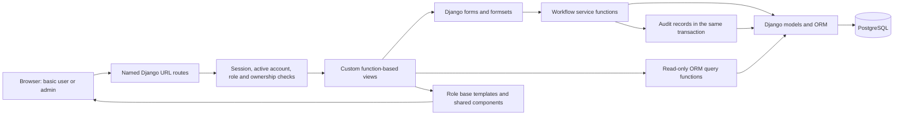
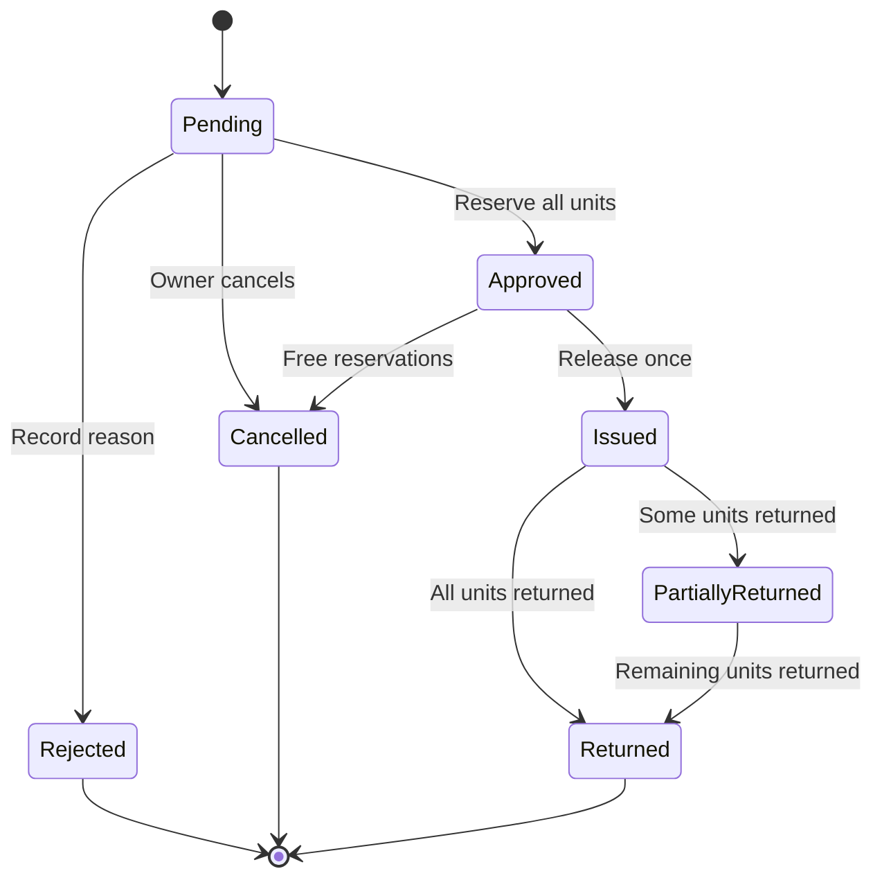

# System Architecture Design

## Status and proposed stack

This architecture guides implementation. T01–T06 and Kenneth's initial T07 are integrated into main; the completed T07 continuation on `jerome` supplies validated catalog management, optional photos/restoration and corrected shared locks. T08 physical units is next after continuation integration. Registration, borrower workflows, maintenance and live reporting remain planned. [The backlog](tasks.md#verified-task-evidence) owns current publication/integration evidence. Behavioral authority is [SRS.md](SRS.md); persistence is specified in [db_design.md](db_design.md) and the actual models/migrations. The canonical [coding standards](coding-standards.md) define MTV responsibility boundaries and implementation/review rules.

Use a single server-rendered Django application with Python 3.13, Django 5.2 LTS, PostgreSQL 17, and Psycopg 3. Pin tested patch versions during implementation. Django 5.2 supports the proposed Python series and database; consult the [release notes](https://docs.djangoproject.com/en/5.2/releases/5.2/) and [database documentation](https://docs.djangoproject.com/en/5.2/ref/databases/).

HTML/CSS and minimal JavaScript serve both roles. The user selected Tailwind CSS for styling. Ordinary Django forms and links handle the current HTTP interactions; no browser HTTP library is installed. The local npm build, shared HTML shell, and role navigation layouts are implemented. Pending module destinations are protected read-only placeholders as listed in [the HTTP contract](api_spec.md#status-and-interface-choice); feature workflows remain their owners' work. A chart library remains unselected. There are no required external APIs, background workers, message brokers, or separate frontend services.

## Required patterns and selected libraries

The [course brief](Project-Requirements.txt), CO2 and Parts 5–6, requires the following evidence and behavior. A service layer is our implementation choice within its allowed reusable-logic approaches; the brief does not mandate a named GoF pattern.

| Requirement | Project application |
| --- | --- |
| Django MTV and MTV/database/workflow diagrams | Models/ORM persist data, function-based views orchestrate HTTP, and server-rendered templates present pages; the diagrams in the design documents describe those boundaries |
| Reusable business logic | The brief allows functions, services, or model methods. This project uses explicit workflow service functions and read-only query helpers, following the coding guide |
| Template inheritance and reusable components | `templates/base.html` supplies the document/assets; `components/workspace.html` supplies the sticky header, messages, and footer; `operations/manage/base.html` and `accounts/portal/base.html` supply role navigation. Feature pages fill `workspace_content`; form/table fragments can be extracted when needed |
| Compare two suitable system options and justify one | The comparison below is design evidence, rather than a software design pattern; later course evidence must evaluate the implemented system and actual user needs |

Part 5 permits third-party packages when declared and justified, and forbids generating the required custom administration side. Tailwind is not named by the brief; using it under that general rule is our interpretation. It does not generate views, forms, admin pages, or authorization.

The [README dependency disclosure](../README.md#third-party-packages-and-assets) owns package purposes, tradeoffs, runtime/build roles, and license declarations. The [complete inventory](third-party-dependencies.md) lists locked indirect/optional packages as well. Keep those sources current instead of duplicating a second justification table here.

Exact package pins and transitive dependencies are in [package.json](../package.json) and [package-lock.json](../package-lock.json), separate from Python requirements. Build/watch commands and usage belong in [DEV.md](../DEV.md#frontend-assets-tailwind-and-page-scripts). Source fonts retain their OFL notices; include any future browser-bundled package notices with runnable artifacts. Follow the [Tailwind CLI](https://tailwindcss.com/docs/installation/tailwind-cli) and [esbuild](https://esbuild.github.io/getting-started/) documentation.

The canonical [coding guide](coding-standards.md#http-endpoint-design) owns endpoint design, native browser interaction boundaries, Tailwind styling/naming, and formatter responsibilities. These conventions retain the existing HTML/form/session interface; no new REST or JSON endpoint is implemented by documenting them.

## Options comparison

| Option | Benefits | Limitations | Recommendation |
| --- | --- | --- | --- |
| Django monolith with SQLite | Simple local demonstration and few infrastructure dependencies | Django's `select_for_update()` does not lock SQLite rows; this design's concurrency proof cannot be assumed to work there | Allowed by the brief, but not the baseline for this locking design |
| Django monolith with PostgreSQL | Row locking and conditional uniqueness support fit per-unit reservations; shared transactional storage | Requires a database service and documented database configuration | Proposed baseline; verify competing approvals using the actual database |

A separate SPA/backend would add endpoint and client-state work without meeting an additional required capability. Keep Django templates and forms. Django documents row locking, SQLite limitations, and the need for `TransactionTestCase` in its [QuerySet reference](https://docs.djangoproject.com/en/5.2/ref/models/querysets/#select-for-update).

## Model-template-view structure

Views enforce HTTP/access rules and orchestrate forms, services, and rendering. Forms validate submitted shape and field-level values. Services own complete business transitions and database writes. Query functions own list, availability, dashboard, and reporting reads. Models/migrations enforce relational and row-level constraints. Templates render allowed data and named URLs; they do not enforce authorization.

The browser receives HTML, printable HTML, and CSV exports. Small JavaScript enhancements do not replace server validation. Authentication uses Django sessions and CSRF protection.

## Proposed modules and ownership

For the detailed existing/planned directory tree and page placement examples, see [Project Folder Architecture](project-folder-architecture.md). The coding guide remains authoritative for each file's responsibilities.

The five Python app/config directories, shared `static/`, and common template shell below exist. Role templates and feature-specific layers are created when their owners implement the corresponding tasks.

| Module | Responsibility | Primary owner |
| --- | --- | --- |
| `config/` | Settings, root URL configuration, application entry points | Jerome with Alex for security settings |
| `accounts/` | Custom auth user/profile, login, role/active checks, account management, registration/profile | Alex; Ellyssa owns portal-facing registration/profile pages |
| `inventory/` | Categories, items, units, maintenance, availability queries | Kenneth |
| `borrowing/` | Requests/items, allocations, loans/loan units, returns, workflow services | Jerome defines shared models; Ralph owns submission/tracking; Margareth owns approval/release/return |
| `operations/` | Audit logs, settings, dashboard/report queries, exports | Jerome for audit/settings; Alex for dashboard/reports |
| `templates/` | Shared document/role layouts, navigation/messages, T05 pages, and pending module presentation; remaining workflow templates planned | Feature owners; Ellyssa and Ralph coordinate integration |
| `static/` | Source fonts/images/CSS/JavaScript and ignored generated `build/` assets; discovered through STATICFILES_DIRS | Feature owners |

Each Django app keeps models, forms, function-based views, URLs, service/query functions, migrations, and tests close to its feature. Split further only when actual file size or responsibility warrants it. Avoid a generic CRUD framework or unnecessary repository abstraction over Django ORM.

Define the custom user model before the first migration. All foreign keys reference the configured authentication model. Roles come from one field, never from Django admin flags or separate authentication systems. No `admin.site.urls`, built-in admin pages, or admin-generation packages.

## Transaction boundaries and lock order

Every state transition re-reads authoritative database state inside `transaction.atomic()`. Do not rely on availability previously rendered in a page.

For borrowing operations, use the shared order: borrower User row, BorrowRequest row, existing Loan row where applicable, Category rows in ascending ID order, CatalogItem rows in ascending ID order where catalog eligibility is checked, then EquipmentUnit rows in ascending ID order. Lock and re-read related allocation/loan-unit records as needed after their parent and unit locks. Do not acquire the same shared locks in a reverse order in another service. Catalog archival/restoration uses the same parent-before-child category/item locks; account deactivation uses the User lock, so a concurrent transaction cannot pass a stale active-account check.

1. **Submit:** validate the entire formset, lock/recheck borrower and eligible catalog records, capture settings, and create the request/items atomically. No allocations are created.
2. **Approve:** lock borrower, request, eligible category/item records in a consistent parent-before-child order, and candidate units. Recheck Pending state and availability after acquiring locks. Select exactly the requested quantity per item. Insert allocations, set unit statuses and decision fields, and append audit data in one transaction. Any shortage rolls everything back.
3. **Cancel:** lock the owner, request, and reserved units. Recheck owner/state, end reservations, set units Available, set Cancelled, and append audit data together.
4. **Release:** lock borrower, approved request, and assigned units. Validate date and complete allocation sets. Create the one Loan and all LoanUnits, record allocation release timestamps, set units Issued/request Issued, and audit. Allocations remain active until return.
5. **Return:** lock borrower, request, loan, and returning units. Check membership and absent return records; create returns, end allocations, and update unit/request/loan states. Damaged returns open maintenance within this same transaction. Close the loan only if no outstanding unit remains.
6. **Maintenance:** lock the unit and its open maintenance record. Enforce its current inventory state and record opening/repair/retirement plus audit atomically. This service must not subsequently acquire borrowing-parent locks.
7. **Settings/account/catalog changes:** validate allowlisted fields and record the business change and audit together. Request submission reads a single consistent settings row; settings edits do not rewrite existing requests.

When approval needs both category and catalog locks, lock categories in ascending ID order before catalog items; submission uses the same order. Archiving a category checks its child records under that order. This refines the general lock sequence above. Implement one shared lock convention and verify it in review rather than adding independent locking code per view.

A partial unique constraint on `UnitAllocation.unit_id` while `ended_at IS NULL` protects exclusivity in addition to locks. A unique Loan request reference and unique ReturnRecord loan-unit reference prevent duplicate issue/return. Cross-table invariants remain service responsibilities; see [db_design.md](db_design.md).

Never silently skip an unavailable requested quantity or convert an operational conflict into success. Translate recognized validation/state conflicts into explicit errors. Unexpected database errors remain failures. Retrying a mutating transaction after an ambiguous commit is unsafe without a verified idempotency strategy and is not part of this baseline.

## Workflow view

Overdue is calculated from outstanding loan units and the local date, so it is not a node in the persisted request workflow. Unit maintenance/retirement transitions are separate from request status.

## Reads, reporting, and privacy

Query ORM data directly for the required live cards/charts/reports. Use `select_related`, `prefetch_related`, filtering, ordering, pagination, and aggregate/annotate queries where appropriate. Avoid cached counters initially. Query counts independently or aggregate carefully so joining returns does not multiply issued quantities.

Portal query functions take the signed-in owner explicitly and return only allowed fields. Management query functions require admin authorization at the view boundary. CSV and printable slips receive the same access checks as their corresponding pages. Operational notes are never placed into portal template context.

## Configuration and technical limits

Optional catalog photos use local Django file storage in `MEDIA_ROOT/equipment/`. PostgreSQL stores only the ImageField path. The photo services commit their reference and audit in a durable transaction, remove a newly saved file if the database operation fails, and delete superseded uploads after commit. These services must not be nested inside another business transaction. File storage and PostgreSQL are separate resources: a process crash during a write can leave an unreferenced file; a database backup alone does not include media. See [DEV.md](../DEV.md#equipment-photos-and-local-media) for storage, backup and serving guidance. Portal photo access remains T10 work.

[.env.example](../.env.example) is the canonical environment-key inventory. [DEV.md](../DEV.md) explains the private `.env.local` and shared local MCP setup. [config/environment.py](../config/environment.py) validates Django configuration without modifying process values; [config/settings.py](../config/settings.py) selects the custom user, PostgreSQL, and Asia/Manila. The MCP separately loads the file through Node; its `MCP_DATABASE_URL` does not configure Django.

Use timezone-aware timestamps and Asia/Manila calendar dates for due dates. Quantity/duration limits are persisted SystemSetting values, not duplicated environment variables. A single local database-backed demonstration is sufficient; high availability and hosting are outside this design.

PostgreSQL is required to validate the selected locking strategy. SQLite-only tests cannot establish row-lock correctness. Shared locks are implemented in [operations/locking.py](../operations/locking.py), audit writes in [operations/audit.py](../operations/audit.py), settings reads/changes in [operations/queries.py](../operations/queries.py) and [operations/services.py](../operations/services.py), and pure limit/date rules in [operations/validation.py](../operations/validation.py). Foundation integration evidence is in [the backlog](tasks.md#verified-task-evidence). Competing approvals still require T13/T14; workflows, performance, and backup/restore remain unverified.
