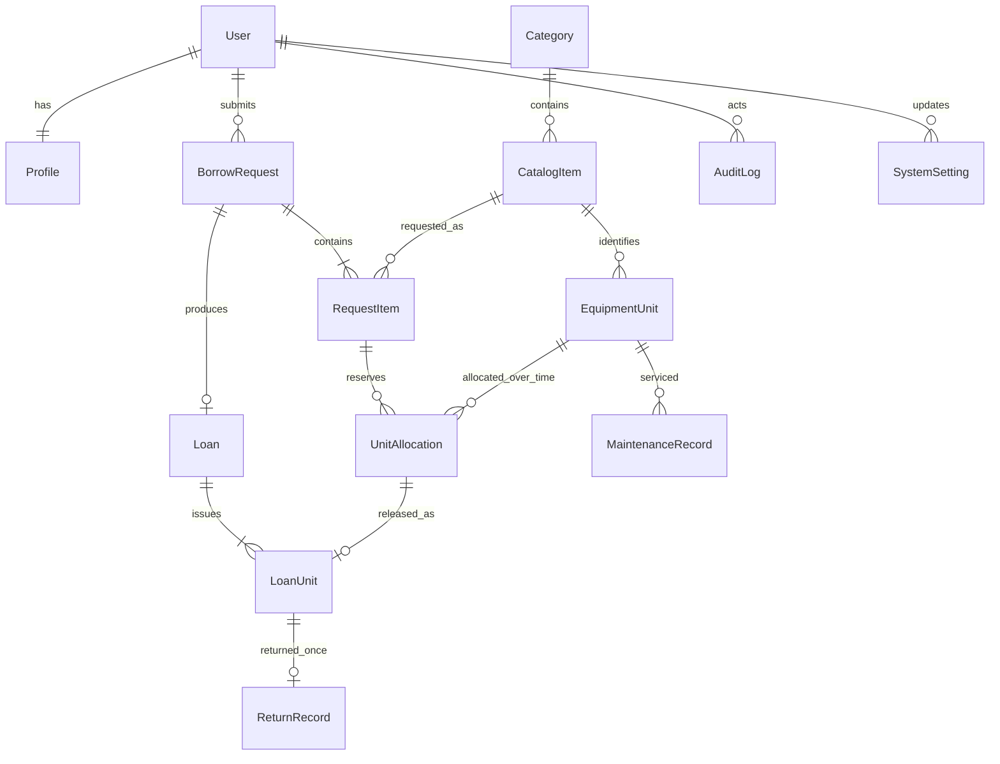

# Database Design

## Status and conventions

Proposed Django ORM model contract; no models, SQL schema, or migrations exist yet. Django migrations will become the executable schema authority when implemented. Workflow rules are maintained in [SRS.md](SRS.md); transaction boundaries in [architecture.md](architecture.md).

Use PostgreSQL, `BigAutoField`/bigint primary keys, timezone-aware `DateTimeField`/timestamptz, and `DateField`/date for calendar dates. All fields are required and NOT NULL unless marked nullable. Text may be blank only when explicitly allowed. Every foreign key is indexed. Transactional references use `PROTECT` deletion behavior; the application has no hard-delete workflow for users, catalog, units, or historical transactions. Profile's one-to-one user relation may use CASCADE but accounts are deactivated, not deleted.

Text lengths and the extra LoanUnit entity below are proposed normalization decisions. Display labels may use spaces/title case; persisted enum values use uppercase snake case. Add database CHECK constraints for enum domains, positive quantities, and same-row temporal invariants; Django choices alone do not create those checks.

## Relationships

The diagram omits secondary actor foreign keys for readability. A persisted request must have 1–3 RequestItems and an issued loan at least one LoanUnit; services enforce those cardinalities atomically.

## Accounts

### User (`accounts.User`)

Use a custom Django `AbstractUser` subclass selected before the first migration. Retain Django password, session, and authentication behavior.

| Field | Type | Constraint/purpose |
| --- | --- | --- |
| `id` | bigint | PK |
| `username` | varchar(150) | Unique; sign-in identifier |
| `password` | varchar(128) | Django-managed hash; never plaintext |
| `first_name`, `last_name` | varchar(150) each | Required nonblank personal names in application forms |
| `email` | varchar(254) | Required contact email; Django/server validation |
| `role` | varchar(10) | CHECK: BASIC_USER or ADMIN |
| `is_active` | boolean | Account activation; required for protected actions |
| `date_joined` | timestamptz | Django-managed account creation time |
| `last_login` | timestamptz, nullable | Django-managed sign-in tracking |

Inherited `is_staff`, `is_superuser`, groups, and permission fields must never create an additional product role or bypass role/activation checks. No built-in admin site is mounted. Runtime management authorization is based on the two-role contract. Registration explicitly assigns BASIC_USER; role is not a public form input.

### Profile

| Field | Type | Constraint/purpose |
| --- | --- | --- |
| `id` | bigint | PK |
| `user_id` | bigint | Unique FK to User; exactly one profile per account through account-creation service |
| `contact_number` | varchar(30), blank allowed | Optional additional contact detail; not a role/identity field |

Keep names/email on User; do not duplicate them in Profile. Passwords, role, and activation are not profile-editable.

## Inventory

### Category

| Field | Type | Constraint/purpose |
| --- | --- | --- |
| `id` | bigint | PK |
| `name` | varchar(100) | Unique, nonblank |
| `description` | text, blank allowed | Description |
| `is_archived` | boolean | False for active categories |
| `created_at`, `updated_at` | timestamptz | Recorded creation/modification times |

### CatalogItem

| Field | Type | Constraint/purpose |
| --- | --- | --- |
| `id` | bigint | PK |
| `category_id` | bigint | FK to Category |
| `name` | varchar(150) | Nonblank |
| `description` | text | Nonblank borrower-facing description |
| `is_archived` | boolean | False for active items |
| `created_at`, `updated_at` | timestamptz | Creation/modification times |

An item is eligible for new requests/approval only when both item and category are active. Availability is derived from EquipmentUnit rows, never stored as an editable catalog quantity.

### EquipmentUnit

| Field | Type | Constraint/purpose |
| --- | --- | --- |
| `id` | bigint | PK |
| `catalog_item_id` | bigint | FK to CatalogItem |
| `asset_code` | varchar(64) | Unique, nonblank; normalize trimming/case consistently before validation |
| `condition` | varchar(10) | CHECK: GOOD, FAIR, DAMAGED |
| `acquired_on` | date | Acquisition date; cannot be in the future on registration |
| `status` | varchar(11) | CHECK: AVAILABLE, RESERVED, ISSUED, MAINTENANCE, RETIRED |
| `internal_notes` | text, blank allowed | Admin-only operational notes |
| `created_at`, `updated_at` | timestamptz | Creation/modification times |

Use a case-insensitive unique constraint for normalized asset codes. Workflow services own status changes. DAMAGED cannot be AVAILABLE, RESERVED, or ISSUED. Preserve the unit's catalog identity and asset code once transaction history exists.

## Requests and allocation

### BorrowRequest

| Field | Type | Constraint/purpose |
| --- | --- | --- |
| `id` | bigint | PK |
| `owner_id` | bigint | FK to User; submitting BASIC_USER |
| `purpose` | text | Nonblank |
| `submitted_at` | timestamptz | Server submission timestamp |
| `submitted_on` | date | Asia/Manila submission date, set once by service |
| `desired_due_date` | date | Original borrower request; immutable |
| `agreed_due_date` | date | Initially desired due date; audited revision only before issue |
| `max_loan_days_applied` | integer | Positive settings snapshot |
| `max_quantity_applied` | integer | Positive per-item settings snapshot |
| `status` | varchar(18) | CHECK: PENDING, APPROVED, REJECTED, CANCELLED, ISSUED, PARTIALLY_RETURNED, RETURNED |
| `decided_by_id` | bigint, nullable | FK to User; deciding ADMIN |
| `decided_at` | timestamptz, nullable | Approval/rejection timestamp |
| `decision_reason` | text, blank allowed | Nonblank once approved/rejected; retained after later transitions |
| `cancelled_by_id` | bigint, nullable | FK to User; cancelling owner |
| `cancelled_at` | timestamptz, nullable | Cancellation timestamp |

DB checks: both due dates > submitted_on; both <= submitted_on + max_loan_days_applied; paired decision actor/time nullability; paired cancellation actor/time nullability; decision reason required when decision data exists. Services ensure snapshot values match settings at submission and submitted_on matches the timestamp's campus date.

### RequestItem

| Field | Type | Constraint/purpose |
| --- | --- | --- |
| `id` | bigint | PK |
| `request_id` | bigint | FK to BorrowRequest |
| `catalog_item_id` | bigint | FK to CatalogItem |
| `quantity` | integer | CHECK > 0; <= request's snapshotted limit through service validation |

Unique `(request_id, catalog_item_id)`. Services enforce 1–3 distinct rows and validate them all before writing. Quantities/items are immutable after submission.

### UnitAllocation

| Field | Type | Constraint/purpose |
| --- | --- | --- |
| `id` | bigint | PK |
| `request_item_id` | bigint | FK to RequestItem |
| `unit_id` | bigint | FK to EquipmentUnit |
| `allocated_at` | timestamptz | Reservation time |
| `allocated_by_id` | bigint | FK to User; approving ADMIN |
| `released_at` | timestamptz, nullable | Issue time; does not end exclusivity |
| `cancelled_at` | timestamptz, nullable | Cancellation time; only before release |
| `ended_at` | timestamptz, nullable | Null while reserved/issued; set on cancellation or return |

Unique `(request_item_id, unit_id)`. Conditional unique `unit_id WHERE ended_at IS NULL`. CHECK all non-null event times >= allocated_at; released_at and cancelled_at cannot both be set; cancellation implies ended_at = cancelled_at; ended_at cannot precede released_at. An allocation may end only by cancellation or a recorded return, enforced by services. A released allocation remains active even though its `released_at` is set.

The service verifies that unit.catalog_item_id equals request_item.catalog_item_id and allocates exactly each requested quantity. No ordinary API directly edits allocations.

## Issue and return

### Loan

| Field | Type | Constraint/purpose |
| --- | --- | --- |
| `id` | bigint | PK |
| `request_id` | bigint | Unique FK to BorrowRequest; one issued loan per request |
| `issued_by_id` | bigint | FK to User; releasing ADMIN |
| `issued_at` | timestamptz | Server release timestamp |
| `issued_on` | date | Asia/Manila release date |
| `due_date` | date | Agreed due-date snapshot at release |
| `closed_at` | timestamptz, nullable | Set only after the final unit return |

CHECK due_date >= issued_on; closed_at >= issued_at when present. Service verifies the request's state, due-date match, complete reservations, and active borrower. Borrower is obtained through request.owner; do not duplicate it on Loan. No stored overdue boolean or editable loan status.

### LoanUnit

| Field | Type | Constraint/purpose |
| --- | --- | --- |
| `id` | bigint | PK |
| `loan_id` | bigint | FK to Loan |
| `allocation_id` | bigint | Unique FK to UnitAllocation; one release per allocation |

This normalized bridge explicitly identifies which allocation was issued on which loan. The service verifies the allocation's RequestItem belongs to loan.request and that all the request's active reservations are issued exactly once. Unit/item identity is derived through the allocation rather than duplicated.

### ReturnRecord

| Field | Type | Constraint/purpose |
| --- | --- | --- |
| `id` | bigint | PK |
| `loan_unit_id` | bigint | Unique FK to LoanUnit; prevents duplicate returns |
| `returned_at` | timestamptz | Server return timestamp |
| `returned_condition` | varchar(10) | CHECK: GOOD, FAIR, DAMAGED |
| `received_by_id` | bigint | FK to User; receiving ADMIN |
| `notes` | text, blank allowed | Admin-only return observations |

Cross-table checks require returned_at >= Loan.issued_at, valid loan membership, an issued active allocation, and the matching unit status. The return service ends the allocation and routes the unit to Available or Maintenance atomically.

## Maintenance, settings, and audit

### MaintenanceRecord

| Field | Type | Constraint/purpose |
| --- | --- | --- |
| `id` | bigint | PK |
| `unit_id` | bigint | FK to EquipmentUnit |
| `source_return_id` | bigint, nullable | Unique FK to ReturnRecord for a damaged return; null for manual maintenance |
| `problem` | text | Nonblank |
| `action` | text, blank allowed while open | Nonblank at closure |
| `opened_at` | timestamptz | Opening timestamp |
| `opened_by_id` | bigint | FK to User; responsible opening ADMIN |
| `closed_at` | timestamptz, nullable | Closure timestamp |
| `closed_by_id` | bigint, nullable | FK to User; closing ADMIN |
| `status` | varchar(6) | CHECK: OPEN, CLOSED |
| `outcome` | varchar(9), nullable | CHECK when present: AVAILABLE or RETIRED; set only on closure |

Conditional unique `unit_id WHERE status = 'OPEN'`. OPEN requires closed_at/closed_by/outcome null; CLOSED requires all three and nonblank action; closed_at >= opened_at. A linked return must be damaged and identify this unit. Services preserve the one effective unit status and reject maintenance on reserved or issued units.

### SystemSetting

One typed singleton row, not an arbitrary key/value store.

| Field | Type | Constraint/purpose |
| --- | --- | --- |
| `id` | smallint | PK; CHECK = 1 |
| `max_loan_days` | integer | CHECK > 0; initial seeded value 7 |
| `max_quantity_per_item` | integer | CHECK > 0; initial seeded value 3 |
| `updated_at` | timestamptz | Modification time |
| `updated_by_id` | bigint, nullable | FK to User; null only for initial system initialization |

A migration/controlled seed creates the singleton. A missing row is a configuration error, not a signal to silently invent settings. The maximum of three distinct catalog items is a fixed brief constraint, not a third setting.

### AuditLog

| Field | Type | Constraint/purpose |
| --- | --- | --- |
| `id` | bigint | PK |
| `actor_id` | bigint, nullable | FK to User; null only for explicitly identified system initialization actions |
| `actor_kind` | varchar(6) | CHECK: USER or SYSTEM; actor null exactly when SYSTEM |
| `action` | varchar(40) | Validated enum of approved business actions |
| `occurred_at` | timestamptz | Server event time |
| `target_model` | varchar(64) | Allowlisted app/model label |
| `target_id` | bigint | Referenced primary key; preserved historical reference |
| `summary` | text | Sanitized action description, reason, and relevant before/after values |

Action values include REQUEST_APPROVED, REQUEST_REJECTED, REQUEST_CANCELLED, DUE_DATE_REVISED, LOAN_RELEASED, UNIT_RETURNED, MAINTENANCE_OPENED, MAINTENANCE_CLOSED, ACCOUNT_CREATED, ACCOUNT_UPDATED, ACCOUNT_ACTIVATED, ACCOUNT_DEACTIVATED, CATEGORY_CREATED, CATEGORY_UPDATED, CATEGORY_ARCHIVED, ITEM_CREATED, ITEM_UPDATED, ITEM_ARCHIVED, UNIT_CREATED, UNIT_UPDATED, and SETTINGS_UPDATED.

`target_model`/`target_id` are a validated historical reference, not a polymorphic database FK; services check the target at creation. Do not store secrets, password hashes, tokens, or unnecessary contact information in summaries. Append only through business services; no ordinary edit/delete routes. SYSTEM is an audit actor kind, not a third user role.

## Indexes and enforcement boundaries

In addition to PK/FK/unique indexes, plan `(owner_id, submitted_at)` and `(status, submitted_at)` on BorrowRequest; `(catalog_item_id, status)` on EquipmentUnit; `issued_at` and `due_date` on Loan; `(status, opened_at)` on MaintenanceRecord; and `occurred_at`, `action`, `(target_model, target_id)` on AuditLog. Add further indexes only after inspecting actual queries.

Database constraints handle row-level validity and uniqueness. Django transaction services handle role/activation checks, row-count limits, cross-table identity, complete allocation, state transitions, settings snapshots, unit-status consistency, event sequencing across tables, and audit completeness. A CHECK constraint cannot query related rows; do not represent service rules as already enforced database constraints.

Use real PostgreSQL integration tests to verify both layers. Historical seed data must use internally consistent dates and relationships; it must not disable constraints or introduce operational bypass endpoints.
