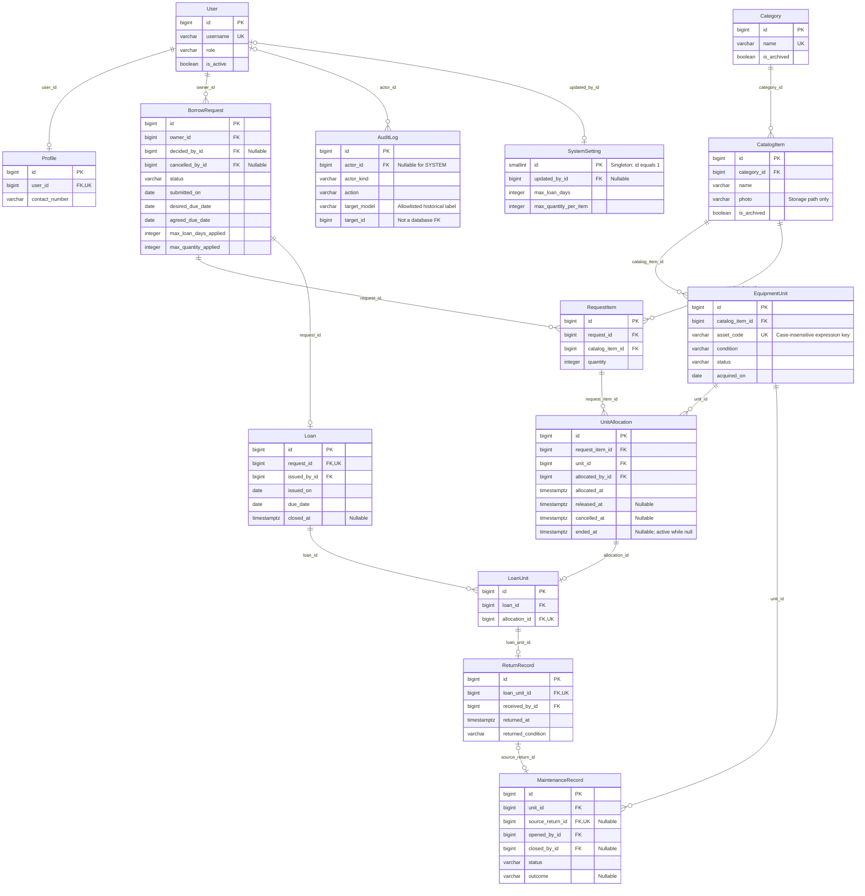
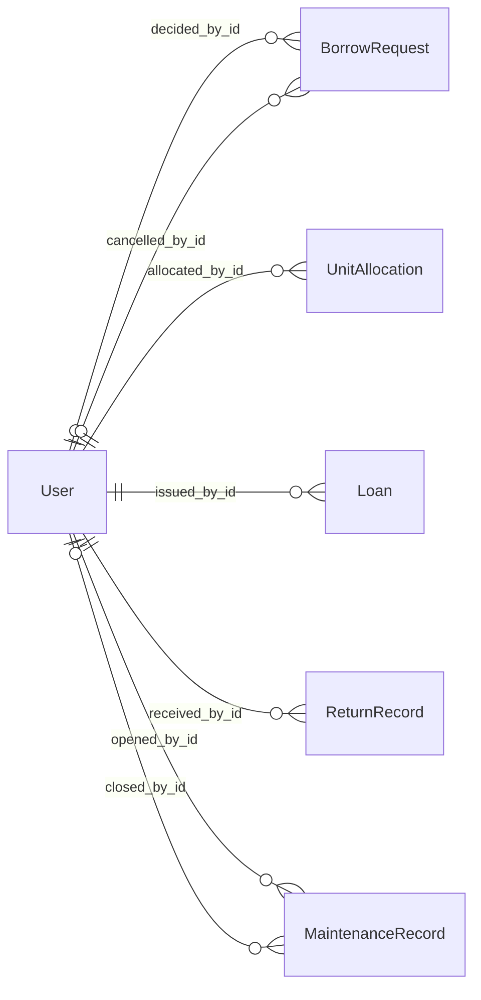

# Database Design

## Status and conventions

The shared schema is implemented in [accounts/models.py](../accounts/models.py), [inventory/models.py](../inventory/models.py), [borrowing/models.py](../borrowing/models.py), and [operations/models.py](../operations/models.py), with Django migrations as executable schema authority. Implemented workflow coverage and remaining owners' work are recorded in the backlog. Workflow rules are maintained in [SRS.md](SRS.md); transaction boundaries in [architecture.md](architecture.md). Acceptance and main integration evidence remain separate in [tasks.md](tasks.md#verified-task-evidence). The [T24 recovery record](operational-verification.md#backup-and-recovery-demonstration) verifies a separate local restore of the implemented schema/data, integrated through PR #58 at `478eab3`. The relationships and drawing notes below were reconciled with all 14 domain models and their migration state at main `e2c3f61` on October 22, 2026 for Jerome's authorized T25 documentation preparation. Jerome accepted the supplied PDF exports for T25 on October 23, 2026; the Mermaid blocks remain the editable sources. Delivery is Done locally and not yet integrated; export links and display limits are recorded below. See [T25 delivery guidance](../DEV.md#t25-readiness-and-consumer-handoff).

Use PostgreSQL, `BigAutoField`/bigint primary keys, timezone-aware `DateTimeField`/timestamptz, and `DateField`/date for calendar dates. All fields are required and NOT NULL unless marked nullable. Text may be blank only when explicitly allowed. Every foreign key is indexed. Transactional references use `PROTECT` deletion behavior; the application has no hard-delete workflow for users, catalog, units, or historical transactions. Profile's one-to-one user relation may use CASCADE but accounts are deactivated, not deleted.

Text lengths and the LoanUnit entity below follow the implemented shared schema and services. Display labels may use spaces/title case; persisted enum values use uppercase snake case. The models/migrations implement CHECK constraints for enum domains, positive quantities, and the same-row temporal invariants listed below; Django choices alone do not create those checks.

## Relationships

The core view includes every domain model. The actor view completes its foreign-key relationships without crowding the borrowing chain. PK/FK/UK mean primary/foreign/unique key. Entity boxes show keys and selected business fields; the field tables below are the full domain data dictionary.

### Actor relationships

These seven edges supplement the core view; all arrows are labelled with actual child FK columns. Nullable actor references become populated only when that event occurs. Their ADMIN/BASIC_USER meaning is enforced by services, not by separate role tables.

### Database drawing guide

Use the two views together: 14 domain entities and all 23 domain FK/one-to-one fields. Group accounts, inventory, borrowing and operations by app. In Lucidchart, use crow's-foot ends: `||` exactly one, `o|` zero or one, `o{` zero or many. Read the symbol beside an entity as the number of that entity per row at the opposite end. FK columns are on the child; a nullable FK permits zero parents, while a required FK permits exactly one. Diagram optionality describes persisted schema, with these additional business annotations:

- Profile.user is required/unique, but a User row alone does not guarantee a Profile row. Supported account creation writes exactly one profile. The User end of that edge must be `||`; the Profile end remains `o|` at schema level.
- Every saved application request has 1-3 RequestItems, and an issued loan at least one LoanUnit. A foreign key cannot enforce a parent's minimum child count; services enforce these counts atomically. Thus schema crow's feet show zero-or-many, with the application minimum written as a note.
- A request has zero or one Loan; an allocation zero or one LoanUnit; a LoanUnit zero or one ReturnRecord. Do not replace the LoanUnit bridge with a direct Loan-to-EquipmentUnit FK. Unit identity follows LoanUnit -> UnitAllocation -> EquipmentUnit; borrower identity follows Loan -> BorrowRequest -> User.
- A MaintenanceRecord may link to zero or one source ReturnRecord; each ReturnRecord has at most one linked maintenance record. Manual/initial maintenance has no source return. The return service requires a linked return to be DAMAGED and to identify that same unit.
- User-to-AuditLog is optional on the User side because SYSTEM events have no actor. SystemSetting.updated_by is nullable for initialization. There can be only one SystemSetting row globally (`id = 1`), so at most one is associated with any updater.
- Put composite/conditional uniqueness in notes: RequestItem `(request_id, catalog_item_id)`; UnitAllocation `(request_item_id, unit_id)` plus one active allocation per `unit_id WHERE ended_at IS NULL`; one OPEN MaintenanceRecord per unit. `unit_id` is not globally unique in allocation/maintenance history. Category names and asset codes have case-insensitive uniqueness.
- AuditLog.target_model/target_id are validated historical references, not a database FK or an extra entity. Settings are a typed singleton, not a key/value table. Overdue, available counts and loan progress are calculated, not extra stored columns/tables.
- Django auth Group/Permission and join tables, sessions, content types and migration history are framework support tables omitted from this domain ERD. The inherited User fields/M2M relations remain in [accounts/models.py](../accounts/models.py) and its [initial migration](../accounts/migrations/0001_initial.py); they do not add product roles. The T24 recovery's 22-table count includes framework tables and is not a domain-model count.

**Delivered ERD diagrams:** [core relationships PDF](Relationships.pdf) and [actor relationships PDF](Actor%20relationships.pdf), supplied October 23, 2026 and accepted by Jerome for T25. The two Mermaid blocks above remain the editable sources; use both views and the field dictionary together. PDF metadata identifies Mermaid Diagram Designer / MermaidEditor.io. Relationship-label bars in both PDFs render without text; the labeled Mermaid diagrams and FK dictionary retain that information. This export display limitation is recorded in the [T25 delivery record](../handoffs/t25-pdf-diagram-delivery-and-documentation-closure-10-23-2026.md). Models and migrations remain authoritative if the schema later changes.

## Accounts

### User (`accounts.User`)

Use a custom Django `AbstractUser` subclass selected before the first migration. Retain Django password, session, and authentication behavior.

| Field | Type | Constraint/purpose |
| --- | --- | --- |
| `id` | bigint | PK |
| `username` | varchar(150) | Unique; accepted sign-in identifier |
| `password` | varchar(128) | Django-managed hash; never plaintext |
| `first_name`, `last_name` | varchar(150) each | Required nonblank personal names in application forms |
| `email` | varchar(254) | Required contact email; Django/server validation; not unique. AUTH-02 permits case-insensitive sign-in only when the combined username/email lookup identifies one account |
| `role` | varchar(10) | CHECK: BASIC_USER or ADMIN |
| `is_active` | boolean | Account activation; required for protected actions |
| `date_joined` | timestamptz | Django-managed account creation time |
| `last_login` | timestamptz, nullable | Django-managed sign-in tracking |

Inherited `is_staff`, `is_superuser`, groups, and permission fields must never create an additional product role or bypass role/activation checks. No built-in admin site is mounted. Runtime management authorization is based on the two-role contract. Registration explicitly assigns BASIC_USER; role is not a public form input.

### Profile

| Field | Type | Constraint/purpose |
| --- | --- | --- |
| `id` | bigint | PK |
| `user_id` | bigint | Unique FK to User; exactly one profile per account through account-creation services |
| `contact_number` | varchar(30), blank allowed | Optional additional contact detail; not a role/identity field |

Keep names/email on User; do not duplicate them in Profile. Passwords, role, and activation are not profile-editable.

## Inventory

### Category

| Field | Type | Constraint/purpose |
| --- | --- | --- |
| `id` | bigint | PK |
| `name` | varchar(100) | Case-insensitive unique, nonblank; management inputs are trimmed |
| `description` | text, blank allowed | Description |
| `is_archived` | boolean | False for active categories |
| `created_at`, `updated_at` | timestamptz | Recorded creation/modification times |

### CatalogItem

| Field | Type | Constraint/purpose |
| --- | --- | --- |
| `id` | bigint | PK |
| `category_id` | bigint | FK to Category |
| `name` | varchar(150) | Nonblank |
| `description` | text | Nonblank borrower-facing description |
| `photo` | varchar(100), blank allowed | Optional ImageField storage key under `equipment/`; local MEDIA_ROOT or private Object Storage selected by Django storage; generated WebP filename, no image binary in PostgreSQL |
| `is_archived` | boolean | False for active items |
| `created_at`, `updated_at` | timestamptz | Creation/modification times |

An item is eligible for new requests/approval only when both item and category are active. Availability is derived from EquipmentUnit rows, never stored as an editable catalog quantity.

### EquipmentUnit

| Field | Type | Constraint/purpose |
| --- | --- | --- |
| `id` | bigint | PK |
| `catalog_item_id` | bigint | FK to CatalogItem |
| `asset_code` | varchar(64) | Unique, nonblank; normalize trimming/case consistently before validation |
| `condition` | varchar(10) | CHECK: GOOD, FAIR, DAMAGED |
| `acquired_on` | date | Acquisition date; cannot be in the future on registration |
| `status` | varchar(11) | CHECK: AVAILABLE, RESERVED, ISSUED, MAINTENANCE, RETIRED |
| `internal_notes` | text, blank allowed | Admin-only operational notes |
| `created_at`, `updated_at` | timestamptz | Creation/modification times |

Use a case-insensitive unique constraint for normalized asset codes. Workflow services own status changes. DAMAGED cannot be AVAILABLE, RESERVED, or ISSUED. Preserve the unit's catalog identity and asset code once transaction history exists.

## Requests and allocation

### BorrowRequest

| Field | Type | Constraint/purpose |
| --- | --- | --- |
| `id` | bigint | PK |
| `owner_id` | bigint | FK to User; submitting BASIC_USER |
| `purpose` | text | Nonblank |
| `submitted_at` | timestamptz | Server submission timestamp |
| `submitted_on` | date | Asia/Manila submission date, set once by service |
| `desired_due_date` | date | Original borrower request; immutable |
| `agreed_due_date` | date | Initially desired due date; audited revision only before issue |
| `max_loan_days_applied` | integer | Positive settings snapshot |
| `max_quantity_applied` | integer | Positive per-item settings snapshot |
| `status` | varchar(18) | CHECK: PENDING, APPROVED, REJECTED, CANCELLED, ISSUED, PARTIALLY_RETURNED, RETURNED |
| `decided_by_id` | bigint, nullable | FK to User; deciding ADMIN |
| `decided_at` | timestamptz, nullable | Approval/rejection timestamp |
| `decision_reason` | text, blank allowed | Nonblank once approved/rejected; retained after later transitions |
| `cancelled_by_id` | bigint, nullable | FK to User; cancelling owner |
| `cancelled_at` | timestamptz, nullable | Cancellation timestamp |

DB checks: both due dates > submitted_on; both <= submitted_on + max_loan_days_applied; paired decision actor/time nullability; paired cancellation actor/time nullability; decision reason required when decision data exists. Services ensure snapshot values match settings at submission and submitted_on matches the timestamp's campus date.

### RequestItem

| Field | Type | Constraint/purpose |
| --- | --- | --- |
| `id` | bigint | PK |
| `request_id` | bigint | FK to BorrowRequest |
| `catalog_item_id` | bigint | FK to CatalogItem |
| `quantity` | integer | CHECK > 0; <= request's snapshotted limit through service validation |

Unique `(request_id, catalog_item_id)`. Services enforce 1–3 distinct rows and validate them all before writing. Quantities/items are immutable after submission.

### UnitAllocation

| Field | Type | Constraint/purpose |
| --- | --- | --- |
| `id` | bigint | PK |
| `request_item_id` | bigint | FK to RequestItem |
| `unit_id` | bigint | FK to EquipmentUnit |
| `allocated_at` | timestamptz | Reservation time |
| `allocated_by_id` | bigint | FK to User; approving ADMIN |
| `released_at` | timestamptz, nullable | Issue time; does not end exclusivity |
| `cancelled_at` | timestamptz, nullable | Cancellation time; only before release |
| `ended_at` | timestamptz, nullable | Null while reserved/issued; set on cancellation or return |

Unique `(request_item_id, unit_id)`. Conditional unique `unit_id WHERE ended_at IS NULL`. CHECK all non-null event times >= allocated_at; released_at and cancelled_at cannot both be set; cancellation implies ended_at = cancelled_at; ended_at cannot precede released_at. An allocation may end only by cancellation or a recorded return, enforced by services. A released allocation remains active even though its `released_at` is set.

The service verifies that unit.catalog_item_id equals request_item.catalog_item_id and allocates exactly each requested quantity. No ordinary API directly edits allocations.

## Issue and return

T15's issue services are implemented and integrated through PR #42 at `744bc39`; current acceptance/publication/integration evidence belongs in [the backlog](tasks.md#verified-task-evidence). T17 uses the existing ReturnRecord and damaged-return maintenance schema without a migration. Its return endpoint/service is integrated through PR #43 at `55899d0`, source `bd62ed7`; see [the consumer handoff](../DEV.md#t17-readiness-and-consumer-handoff).

### Loan

| Field | Type | Constraint/purpose |
| --- | --- | --- |
| `id` | bigint | PK |
| `request_id` | bigint | Unique FK to BorrowRequest; one issued loan per request |
| `issued_by_id` | bigint | FK to User; releasing ADMIN |
| `issued_at` | timestamptz | Server release timestamp |
| `issued_on` | date | Asia/Manila release date |
| `due_date` | date | Agreed due-date snapshot at release |
| `closed_at` | timestamptz, nullable | Set only after the final unit return |

CHECK due_date >= issued_on; closed_at >= issued_at when present. Service verifies the request's state, due-date match, complete reservations, and active borrower. Borrower is obtained through request.owner; do not duplicate it on Loan. No stored overdue boolean or editable loan status.

### LoanUnit

| Field | Type | Constraint/purpose |
| --- | --- | --- |
| `id` | bigint | PK |
| `loan_id` | bigint | FK to Loan |
| `allocation_id` | bigint | Unique FK to UnitAllocation; one release per allocation |

This normalized bridge explicitly identifies which allocation was issued on which loan. The service verifies the allocation's RequestItem belongs to loan.request and that all the request's active reservations are issued exactly once. Unit/item identity is derived through the allocation rather than duplicated.

### ReturnRecord

| Field | Type | Constraint/purpose |
| --- | --- | --- |
| `id` | bigint | PK |
| `loan_unit_id` | bigint | Unique FK to LoanUnit; prevents duplicate returns |
| `returned_at` | timestamptz | Server return timestamp |
| `returned_condition` | varchar(10) | CHECK: GOOD, FAIR, DAMAGED |
| `received_by_id` | bigint | FK to User; receiving ADMIN |
| `notes` | text, blank allowed | Admin-only return observations |

Cross-table checks require returned_at >= Loan.issued_at, valid loan membership, an issued active allocation, and the matching unit status. The return service ends the allocation and routes the unit to Available or Maintenance atomically.

## Maintenance, settings, and audit

### MaintenanceRecord

| Field | Type | Constraint/purpose |
| --- | --- | --- |
| `id` | bigint | PK |
| `unit_id` | bigint | FK to EquipmentUnit |
| `source_return_id` | bigint, nullable | Unique FK to ReturnRecord for a damaged return; null for manual maintenance |
| `problem` | text | Nonblank |
| `action` | text, blank allowed while open | Nonblank at closure |
| `opened_at` | timestamptz | Opening timestamp |
| `opened_by_id` | bigint | FK to User; responsible opening ADMIN |
| `closed_at` | timestamptz, nullable | Closure timestamp |
| `closed_by_id` | bigint, nullable | FK to User; closing ADMIN |
| `status` | varchar(6) | CHECK: OPEN, CLOSED |
| `outcome` | varchar(9), nullable | CHECK when present: AVAILABLE or RETIRED; set only on closure |

Conditional unique `unit_id WHERE status = 'OPEN'`. OPEN requires closed_at/closed_by/outcome null; CLOSED requires all three and nonblank action; closed_at >= opened_at. A linked return must be damaged and identify this unit. Services preserve the one effective unit status and reject maintenance on reserved or issued units.

### SystemSetting

One typed singleton row, not an arbitrary key/value store.

| Field | Type | Constraint/purpose |
| --- | --- | --- |
| `id` | smallint | PK; CHECK = 1 |
| `max_loan_days` | integer | CHECK > 0; initial seeded value 7 |
| `max_quantity_per_item` | integer | CHECK > 0; initial seeded value 3 |
| `updated_at` | timestamptz | Modification time |
| `updated_by_id` | bigint, nullable | FK to User; null only for initial system initialization |

[The initialization migration](../operations/migrations/0002_initial_settings.py) creates the singleton and a SYSTEM/SETTINGS_INITIALIZED audit entry atomically. Its data operation is explicitly irreversible; later schema changes use new migrations. A missing row is a configuration error, not a signal to silently invent settings. The maximum of three distinct catalog items is a fixed brief constraint, not a third setting.

### AuditLog

| Field | Type | Constraint/purpose |
| --- | --- | --- |
| `id` | bigint | PK |
| `actor_id` | bigint, nullable | FK to User; null only for explicitly identified system initialization actions |
| `actor_kind` | varchar(6) | CHECK: USER or SYSTEM; actor null exactly when SYSTEM |
| `action` | varchar(40) | Validated enum of approved business actions |
| `occurred_at` | timestamptz | Server event time |
| `target_model` | varchar(64) | Allowlisted app/model label |
| `target_id` | bigint | Referenced primary key; preserved historical reference |
| `summary` | text | Sanitized action description, reason, and relevant before/after values |

Action values are the `AuditAction` enum in [operations/models.py](../operations/models.py). SETTINGS_INITIALIZED identifies the migration-only SYSTEM event; CATEGORY_RESTORED and ITEM_RESTORED identify the optional catalog restoration actions. The remaining values cover the business actions described above. `AuditTarget` allowlists actual app/model labels, and [the audit writer](../operations/audit.py) checks action/target compatibility and target existence.

`target_model`/`target_id` are a validated historical reference, not a polymorphic database FK; services check the target at creation. Do not store secrets, password hashes, tokens, or unnecessary contact information in summaries. Append only through business services; no ordinary edit/delete routes. SYSTEM is an audit actor kind, not a third user role.

## Indexes and enforcement boundaries

In addition to PK/FK/unique indexes, the implemented model/migration indexes cover `(owner_id, submitted_at)` and `(status, submitted_at)` on BorrowRequest; `(catalog_item_id, status)` on EquipmentUnit; `issued_at` and `due_date` on Loan; `(status, opened_at)` on MaintenanceRecord; and `occurred_at`, `action`, `(target_model, target_id)` on AuditLog. Add further indexes only after inspecting actual queries.

Database constraints handle row-level validity and uniqueness. Django transaction services handle role/activation checks, row-count limits, cross-table identity, complete allocation, state transitions, settings snapshots, unit-status consistency, event sequencing across tables, and audit completeness. A CHECK constraint cannot query related rows; do not represent service rules as already enforced database constraints.

Use real PostgreSQL integration tests to verify both layers. Historical seed data must use internally consistent dates and relationships; it must not disable constraints or introduce operational bypass endpoints.
