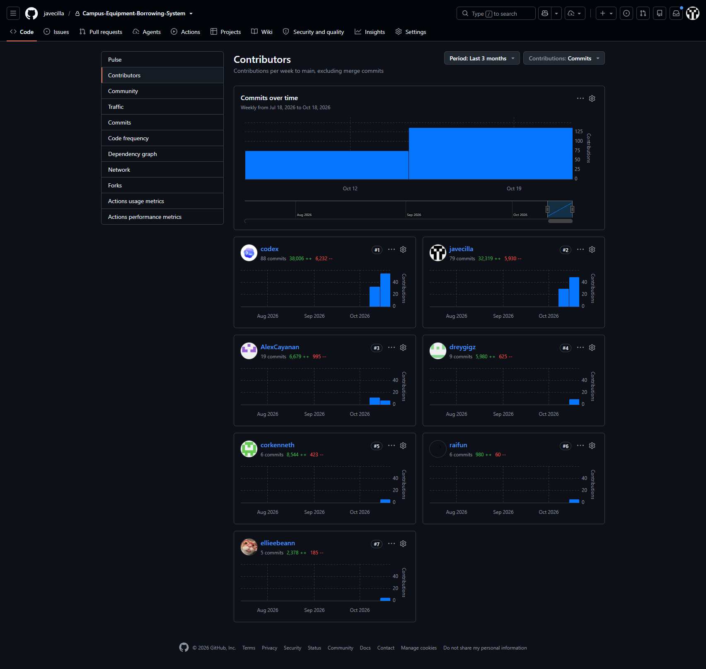
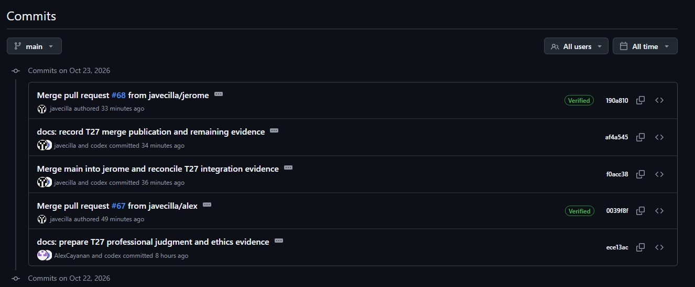
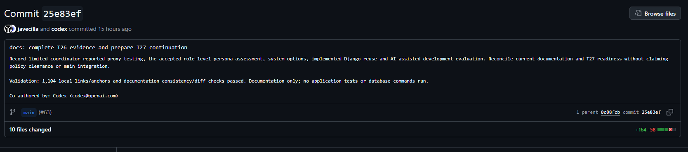

# T27 Professional Judgment, Ethics, Privacy, and Reuse Record

- **Status:** In progress
- **Coordinating owner:** Alex Enrico Cayanan; every member contributes and must be able to defend the final decisions
- **Evidence date:** October 23, 2026, Asia/Manila
- **Scope:** Course prototype, its repository, demonstration data, development practices, and proposed campus use

This is the canonical T27 decision record required by Part 6 of the
[course brief](Project-Requirements.txt) and the [backlog acceptance criteria](tasks.md#course-evidence-and-delivery).
It applies professional judgment to the system that actually exists. It is not legal advice, a BulSU approval,
a privacy-impact-assessment approval, an accessibility-conformance claim, or permission to process real campus data.

## Current decisions

1. **Use fictional operational data only.** Real borrower, employee, transaction, or equipment-custody data must not be
   entered until the responsible BulSU office and Data Protection Officer (DPO) approve the purpose, lawful basis,
   privacy notice, access, hosting/data-sharing, retention/deletion, incident response, and privacy impact assessment.
2. **Keep the two-role, least-privilege boundary.** `BASIC_USER` sees the active catalog and only that user's requests,
   loans, and profile. Active `ADMIN` accounts manage operational records and audit history. There is no payment or fine
   processing. These technical controls reduce risk but do not create institutional authority to use real data.
3. **Do not treat history as permission for indefinite retention.** The application preserves workflow and audit
   history and deactivates accounts, but it has no approved records schedule, anonymization process, or account-deletion
   workflow. A BulSU records owner and DPO must decide those matters before real-data use.
4. **Use WCAG 2.2 Level AA as the evaluation target, not a conformance claim.** Automated, responsive, keyboard, and
   status-label evidence exists, but complete screen-reader, disability-user, and whole-system conformance evaluation
   has not been performed.
5. **Record actual asset origins and review the final package.** Jerome confirmed on October 23 that the project logo,
   default role avatars, default equipment image and equipment images were generated with Gemini. This is attributed
   contributor evidence, not independent verification or a guarantee of exclusive rights. The
   [canonical asset inventory](third-party-dependencies.md#supplied-assets-and-optional-inspection-tooling) records the
   disclosure and terms boundary. Keep font/Chart.js notices; review final images for personal/confidential content and
   third-party material, and record the actual source/license if any internet-sourced image is included later.
6. **Disclose AI assistance without delegating accountability.** Codex and Kiro assistance is identified in handoffs and
   commit trailers; Gemini image generation is now recorded from Jerome's confirmation. The application does not contain
   an AI feature. Real personal data, credentials, private database
   values, and confidential campus material must not be submitted to an AI service. Apply the supplied course brief's
   disclosure requirement and reconcile any additional applicable BulSU/instructor instructions when obtained; no policy
   approval or unrestricted permission is inferred from existing use.

## Evidence boundary

- The application and repository were inspected; no new application behavior, database write, policy approval, human
  study, or legal opinion was created for this record.
- Existing technical evidence includes [Ralph's T17/T27 contribution](../handoffs/ralph-t17-per-unit-returns-and-overdue-10-20-2026.md#ralphs-t27-technical-contribution),
  [T23 usability evidence](usability-acceptance.md), [T24 operational evidence](operational-verification.md), and the
  [T26 options and AI evaluation](user-needs-evidence-guide.md).
- The project's operational demonstration identities use `example.invalid` addresses and fictional names. Contributor
  names in the repository come from the supplied team record and must be handled only for the stated course purpose.
- “Required,” “must,” and “blocked” below describe the project's interim risk controls or cited requirements. They do
  not imply that BulSU, the instructor, the NPC, or another authority has approved the system.

## Primary source register

Sources were reviewed on October 23, 2026. The team must recheck version, applicability, and institutional instructions
at the point of submission or before any real-data pilot.

| Source | Why it is relevant | Project application and boundary |
| --- | --- | --- |
| [Republic Act No. 10173, Data Privacy Act of 2012](https://privacy.gov.ph/data-privacy-act/) and its [Implementing Rules and Regulations](https://privacy.gov.ph/wp-content/uploads/2023/06/IRR_RA-10173-as-amended.pdf) | The system would process identifiable account, contact, borrowing, decision, return, maintenance, and audit data | Apply transparency, legitimate-purpose, proportionality, security, accountability, and data-subject-rights principles. The team has not selected a lawful basis or obtained institutional authority for real data. |
| [BulSU Data Privacy Manual](https://www.bulsu.edu.ph/data-privacy) | Institutional privacy governance for BulSU personnel, students, data subjects, systems, security, sharing, incidents, and the DPO | Treat DPO review, a privacy impact assessment, access control, security, and institutional ownership as preconditions. The public manual does not establish a project-specific borrowing-record retention period. |
| [NPC Circular No. 2023-06, Security of Personal Data](https://privacy.gov.ph/wp-content/uploads/2024/03/NPC-Circular-Repeal-16-01-Signed.pdf) | Current NPC security expectations include governance, system inventory, risk assessment, access policy, training, privacy by design/default, retention, continuity, and incident handling | Existing code contributes access, audit, validation, atomicity, and recovery evidence. Organizational controls and formal approval remain outside the repository and unverified. |
| [NPC Advisory No. 2017-03, Guidelines on Privacy Impact Assessments](https://privacy.gov.ph/wp-content/uploads/2022/01/NPC_AdvisoryNo.2017-03.pdf) | A PIA is the structured way to identify personal-data flows, risks, safeguards, residual risk, and responsibility | This document supplies a preliminary inventory and risk register but is not an approved PIA. The accountable BulSU office and DPO must conduct or accept the actual assessment. |
| [Republic Act No. 10175, Cybercrime Prevention Act of 2012](https://issuances-library.senate.gov.ph/legislative%2Bissuances/Republic%20Act%20No.%2010175) | Unauthorized access, interference, misuse, and credential handling can harm users and operations | Preserve authentication, authorization, logging, private secrets, least privilege, and incident escalation. This record does not certify statutory compliance. |
| [Republic Act No. 8293, Intellectual Property Code](https://elibrary.judiciary.gov.ph/thebookshelf/showdocs/2/4371) and [IPOPHL laws index](https://www.ipophil.gov.ph/reference/laws-issuance-and-treaties/) | Source code, fonts, libraries, photographs, illustrations, and course materials have distinct ownership and license boundaries | Retain notices and attribution, do not extend the project MIT license to third-party/instructor material, and resolve undocumented asset provenance before submission. |
| [Republic Act No. 7277, Magna Carta for Disabled Persons](https://ncda.gov.ph/disability-laws/republic-acts/republic-act-7277/) | Equal participation and removal of barriers are public-welfare duties | Use accessible interaction and communication as a design duty. The law alone does not prove that this web application conforms to an accessibility standard. |
| [WCAG 2.2](https://www.w3.org/TR/WCAG22/) | Testable international web-accessibility guidance | Use Level AA as a project target and disclose untested criteria and assistive-technology gaps. |
| [Republic Act No. 9470, National Archives of the Philippines Act](https://issuances-library.senate.gov.ph/legislative%2Bissuances/Republic%20Act%20No.%209470) | An adopted university system may create public records subject to records-management duties | The authorized records officer, not the development team, must classify records and approve retention/disposal. No project-specific schedule is inferred here. |
| [ACM Code of Ethics and Professional Conduct](https://www.acm.org/code-of-ethics) | Prioritizes the public good, avoiding harm, honesty, fairness, privacy, confidentiality, security, competence, and accountability | Disclose limitations, preserve confidentiality and contributor credit, test proportionately, and stop unsafe data use rather than overstate readiness. |
| [Software Engineering Code of Ethics and Professional Practice](https://www.computer.org/education/code-of-ethics) | Applies public-interest, quality, judgment, management, profession, colleague, and self-improvement duties to software work | Preserve truthful evidence, review others' work fairly, credit contributors, disclose risks, and avoid claims beyond the checks performed. |
| [NPC Advisory No. 2024-04, AI systems processing personal data](https://privacy.gov.ph/wp-content/uploads/2025/02/Advisory-2024.12.19-Guidelines-on-Artificial-Intelligence-w-SGD.pdf) | Applies if AI development or deployment processes personal data; addresses lawful basis, transparency, accountability, fairness, human intervention, rights, and PIA/governance | The product has no AI feature. Any future AI feature or AI use involving personal data requires a new scope decision and privacy review; this source does not substitute for the missing BulSU/instructor AI rules. |
| [Codex authentication](https://learn.chatgpt.com/docs/auth), [agent approvals and security](https://learn.chatgpt.com/docs/agent-approvals-security), and [OpenAI API data controls](https://developers.openai.com/api/docs/guides/your-data) | The sign-in route, account/workspace settings, approvals, sandbox, network access, and API organization controls affect development-data handling | Keep secrets out of source and prompts, use minimum access, and verify the actual account/workspace controls before sensitive work. The repository does not record which current account controls apply, and API controls must not be assumed for a ChatGPT-authenticated session. |

### Institutional sources still required

The course brief requires disclosure under the **BulSU AI Policy and instructor instructions**. Jerome reports on
October 23 that no separate disclosure format or additional instruction has been supplied; the available instruction is
the course brief's requirement to disclose AI use. The actual university policy text is not in the repository, and the
official-site search did not locate it. This record supplies the disclosure under the available brief, while university
policy compliance remains unverified. Alex/Jerome should clarify applicable rules during final review and reconcile any
actual policy/instructor instruction obtained, retaining its title/version/date and source.
The team must also obtain project-specific privacy/records decisions from the appropriate BulSU office before real-data
use. Absence of a located public document is not evidence that no rule exists.

## Stakeholders, duties, and accountability

| Stakeholder | Interest or possible harm | Project duty | Accountable decision or evidence owner |
| --- | --- | --- | --- |
| Campus borrowers, including students | Correct availability/status, confidentiality, fair treatment, accessible use, and a way to correct account data | Collect only necessary data; enforce ownership; explain status and errors; prevent exposure or arbitrary treatment | Account/security owner and borrower-portal/workflow owners; final institutional owner still to be named |
| Equipment administrators/custodians | Reliable inventory, safe issue/return/maintenance decisions, accountable actions, and recoverable records | Require active admin access; validate transitions; preserve actor/time; train against unnecessary free-text personal data | Admin/workflow owners; actual BulSU custodian/process owner still to be named |
| People represented in photographs or free text | Avoid non-consensual capture, identification, disclosure, or reputational harm | Prohibit people/IDs/confidential material in equipment images and unnecessary PII in purpose, reason, note, or maintenance fields | Uploading admin and institutional owner; team verifies demo/submission assets |
| Six-member development team | Fair credit, safe access, accurate evidence, maintainable work, and individual ability to explain decisions | Follow assigned branches/review gates, protect credentials, preserve provenance, disclose assistance, and report only performed checks | Jerome coordinates delivery; Alex coordinates T27 security/privacy; every member owns their contribution and defense |
| BulSU, its DPO, records officer, and system/process owner | Legal/institutional authority, security, records management, incident response, and public trust | Approve purpose, lawful basis, notice, access, processor/data-sharing terms, PIA, retention/disposal, and incident ownership | Not yet identified/approved for this project; this blocks real-data use |
| Instructor/evaluator | Authentic work, compliance with course instructions, traceable evidence, and individual understanding | Receive truthful reuse/AI disclosure, limitations, sources, and contribution evidence | Instructor provides/clarifies rules; team records and follows them |
| Software, hosting, database, storage, and AI service providers | Secure and license-compliant use within service terms and account controls | Minimize transferred data, verify configuration and terms, restrict access, retain notices, and avoid unsupported guarantees | Team/coordinator for prototype accounts; institutional owner for any adopted service |
| Future maintainers and the public | Avoid unsafe deployment, misleading claims, lost history, inaccessible service, or corrupted inventory | Keep handoffs, tests, recovery limits, unresolved risks, and change approvals visible | Repository owner and future authorized maintainers |

## Personal-data and record lifecycle

| Data or record | Current purpose and access | Existing safeguard/evidence | Unresolved decision before real-data use |
| --- | --- | --- | --- |
| Account identity: username, first/last name, email, role, active state, password credentials | Authentication, contact, role routing; user edits own allowed profile fields and admins manage accounts | Django password handling; active-account and role checks; unique identity validation; protected views | Institutional purpose/lawful basis, notice, identity verification, correction process, authorized admins, retention/deletion, breach contact |
| Optional contact number | Borrower contact | Optional field; owner profile edit and administrative account access | Demonstrated necessity, notice, format/accuracy rules, access and retention; omit if the process does not require it |
| Request purpose, items, dates, status, decision actor/reason, cancellation actor | Borrowing review, allocation, history, accountability | Owner-scoped borrower access; admin workflow access; atomic transitions and audit evidence | Free-text minimization guidance, prohibited sensitive content, lawful basis, retention, correction/appeal and reporting boundaries |
| Loan, unit issue, due date, return condition, return notes | Custody, due/overdue status, partial return, damage handling | Owner access to own loan; active-admin workflow; per-unit state and atomic return evidence | Approved records schedule, dispute/correction process, who may export/report, and post-retention deletion/anonymization |
| Unit internal notes and maintenance problem/action text | Equipment condition and repair history | Active-admin access and audited workflow | Prohibit unnecessary personal data; define content standard, access, retention, disposal, and safety/escalation owner |
| Audit actor, action, time, target, and summary | Accountability, investigation, workflow traceability | Server-generated actor/time and admin-only history; audit writes participate in transactions | Approved access and retention; audit integrity review; incident-use process; handling when an account/data subject requests deletion |
| Equipment photographs | Identify equipment in catalog | Admin-only upload/change; authenticated role-specific delivery; size/type/pixel validation; re-encoding to WebP removes source metadata; private/no-store responses | Rights/permission, no-person/ID/confidential-content rule, review owner, retention/removal, hosted-storage approval |
| Logs, backups, exports, screenshots, and test artifacts | Operation, recovery, verification, reporting, submission evidence | Secrets and private artifacts are excluded from Git; current demo data is fictional; recovery limits are documented | Formal inventory, access, encryption, retention/deletion, secure disposal, processor/storage approval, breach and restoration responsibility |

The application currently deactivates accounts and protects historical foreign-key references. That is an operational
design choice, not an approved retention rule. The team must not promise erasure or indefinite preservation until the
institutional owner defines how data-subject rights and official-record duties apply to each record category.

## Risk and decision register

| Area and risk | Evidence considered | Current decision and safeguard | Residual risk / required action | Owner and review point |
| --- | --- | --- | --- | --- |
| Real personal data used without authority | Registration/profile fields, transaction actors, free text, audit trail, DPA/IRR, BulSU manual | Use fictional operational data only; do not import class lists or real transactions | Obtain institutional owner/DPO approval, lawful basis, notice, PIA, and processor/data-sharing decisions | Alex coordinates; Jerome and institutional owner approve before any pilot |
| Excessive or sensitive content in free text | Purpose, decision reason, return/maintenance notes | Enter only equipment/transaction facts; no health, disciplinary, financial, ID-number, or unrelated personal details | Add approved field guidance/training or redesign fields before real use | Workflow owners and institutional process owner before pilot |
| Unauthorized access or inactive accounts | Active-role decorators, owner-scoped queries, 404/403 behavior, audit tests | Preserve `BASIC_USER`/`ADMIN`, active-account checks, owner scoping, CSRF/session controls, and no generic status update | Operational admin assignment, periodic access review, MFA/password/session policy, and incident response are unverified | Alex/account owner and institutional system owner before pilot |
| Indefinite history, backups, or exports | Protected foreign keys, deactivation, audit records, CSV, backup/recovery evidence | Do not invent a period or delete records ad hoc; keep demo artifacts controlled | Records officer/DPO must classify each record, set retention/disposal and backup/export handling, and define deletion/anonymization | Institutional records owner/DPO before real data and recheck annually or after change |
| Photo privacy, confidentiality, or unsafe upload | Authenticated delivery, validation, metadata-stripping re-encode, private/no-store response | Equipment-only images; exclude people, IDs, screens, asset labels deemed confidential, location clues, and unrelated surroundings | Human content review, rights evidence, approved storage, removal process, and retention remain required | Uploading admin plus institutional owner; team checks all submission images |
| Asset copyright or misleading ownership | Dependency inventory, OFL/MIT notices, Jerome's Gemini-origin confirmation | Preserve notices and AI/contributor credit; do not imply verified exclusive rights or extend MIT to third-party/instructor material | Review the final image set; disclose any reference material or later internet assets with actual source and permitted-use evidence | Alex coordinates inventory; asset contributor and Jerome verify before T30 |
| Inaccessible interaction or communication | Ralph's T20 responsive/keyboard/error checks, theme contrast checks, T23 limitations | Maintain non-color status text, labels, focus visibility, keyboard use, responsive layout, and WCAG 2.2 AA target | Present the recorded evidence and untested screen-reader/zoom/user limits; further evaluation is recommended before adoption, without a conformance claim | UI owners/every member explain limits at submission/demo; institutional owner before adoption |
| Bias or unfair treatment | Exactly two roles, same business rules, state-machine decisions, free-text admin reasons | Apply availability, quantity, duration, order, and workflow rules consistently; retain actor/reason; no hidden scoring or AI decisions | Admin discretion and unequal device/connectivity/accessibility effects remain; define review/appeal and monitor outcomes if deployed | Institutional process owner; team explains prototype limits at demo |
| Conflict of interest or credit distortion | Member allocations, Git/handoffs, source/merge evidence, co-author records | Review by evidence, preserve every contributor's work, disclose AI/reuse, do not let branch ownership imply sole authorship | Every member must verify their record and disclose unrecorded reuse/assistance | All members before submission; Jerome coordinates final package |
| Operational/public-welfare harm from incorrect inventory or downtime | Atomic workflows, audit logs, tests, T24 performance/recovery limits | Keep validation/locking/audit/recovery guidance; no unverified production claim; manual custodian check remains necessary | No production SLA, backup owner, disaster plan, or support process; wrong status could deny access or lose accountability | Institutional owner before adoption; maintainers after material change |
| Secrets, private data, or code sent to AI/service providers | Git ignore rules, handoffs, Codex disclosures, provider documentation | Never submit credentials, private database values, personal data, or confidential campus material; use minimum tool/network access | Exact account/workspace controls and BulSU/instructor permissions are unverified | Each user for their session; Alex/Jerome verify rules before final disclosure |
| Future AI feature creates opaque or discriminatory decisions | Product currently has no AI feature; NPC AI guidance | No AI approval, ranking, risk scoring, or automated decision feature is in scope | Any proposal requires explicit scope authorization, alternatives analysis, lawful basis, PIA, transparency, human intervention, fairness tests, and rights process | Instructor/institutional owner/DPO plus team before design or data use |

## Accessibility, bias, conflicts, and public welfare findings

- **Demonstrated:** native Django forms, labels, visible state/error text, keyboard focus, responsive layouts, non-color-only
  status labels, active/inactive authorization tests, owner scoping, workflow validation, audit records, concurrency checks,
  and documented performance/recovery exercises.
- **Not demonstrated:** full WCAG 2.2 AA conformance, screen-reader coverage across all pages, a disability-user study,
  formal accommodation workflow, campus-wide device/connectivity representativeness, or deployed incident/support levels.
- **Fairness boundary:** the system applies the same configured quantity/duration and state-transition rules, but an admin
  still exercises judgment in approval, rejection, damage, and maintenance decisions. Actor/reason history supports review;
  it does not by itself create an appeal process or prove absence of bias.
- **Conflict boundary:** repository ownership, branch ownership, or AI assistance does not replace member authorship or
  individual responsibility. Review decisions must rely on requirements and evidence, not who wrote a change.
- **Public-welfare boundary:** incorrect availability, unsafe equipment release, exposed data, or an inaccessible workflow
  could harm borrowers and custodians. The prototype therefore favors validated transitions, conservative data use,
  honest limitations, and a manual institutional decision before deployment.

### Recorded accessibility evidence and disposition

Ralph's work supplies actual evidence; this review does not repeat those browser checks or replace them with a claim
of certification. Historical implementation handoffs retain their original publication state; the
[T20 merged-source review](../handoffs/t20-main-integration-review-and-documentation-10-21-2026.md) and backlog establish
later integration.

| Evidence | Recorded result and scope | Remaining limitation |
| --- | --- | --- |
| [Ralph's T20 verification](../handoffs/ralph-t20-role-workspace-integration-10-21-2026.md#actual-verification) | 17 routes at 1440/1024/768/390/320px; document bounds, headings/navigation, linked field errors, keyboard skip link/focus, overdue anchor and keyboard table scrolling passed in the recorded Chromium run | Screen-reader evaluation and Firefox/Safari were Not run; responsive widths do not by themselves establish zoom/reflow conformance |
| Same T20 record and [Module 19](manual-test-guide.md#module-19--integrated-role-workspaces-t20) | Nine configured theme text-role pairs passed the 4.5:1 contrast check; native validation and JavaScript-disabled empty-state navigation were exercised | The palette check is not an audit of every rendered component or every WCAG criterion |
| [Ralph's T17 contribution](../handoffs/ralph-t17-per-unit-returns-and-overdue-10-20-2026.md) and [dashboard/workspace review](../handoffs/dashboard-and-workspace-publication-review-10-20-2026.md) | Scoped form labels, keyboard focus, responsive views and accessible chart-table alternatives are recorded | These checks do not demonstrate whole-system screen-reader coverage or a disability-user study |

**Coursework disposition:** retain these results, explain the untested limits and avoid a WCAG conformance claim.
The supplied brief requires accessibility analysis and defensible safeguards; it does not explicitly require WCAG
certification, a disability-user study or every browser/assistive-technology combination as a T27 completion gate.
No new accessibility feature or full evaluation is inferred from this document update.

## Intellectual property and asset disposition

| Material | Current evidence | Submission decision |
| --- | --- | --- |
| Original team code and documentation | Root [MIT license](../LICENSE), contributor records, Git history, handoffs | Retain team-wide authorship; do not identify one repository account holder as sole owner |
| Django/Python/npm packages | Pinned locks, license inventory, direct-dependency rationale | Retain lockfiles and required notices; recheck after dependency changes |
| DM Sans and Poppins | Local SIL Open Font License files | Include the font license files with distributed assets |
| Chart.js and `@kurkle/color` | Bundled MIT notice in `static/licenses/chartjs-MIT.txt` | Keep the notice with the static bundle/submission |
| Project logo, default role avatars and default equipment artwork | Jerome confirmed Gemini generation on October 23; see the canonical asset inventory | Disclose the reported AI origin; retain the terms boundary and final content review instead of claiming an unknown internet source or exclusive rights |
| Uploaded/demo equipment images | Jerome's answer to the asset-origin question also identifies these as Gemini-generated | Describe them as illustrative demonstration images, not proof of real campus inventory; review final content and keep their AI-origin disclosure |
| GitHub evidence screenshots | Jerome supplied three repository screenshots, visually inspected for this record | Retain repository/GitHub attribution; use them as contribution/disclosure evidence, not a measurement of human effort or instructor approval |
| Instructor/course materials | Supplied requirements and rubric-related records | Reference for coursework only; do not claim project MIT ownership over them |

The detailed dependency and supplied-asset inventory remains canonical in
[Third-party dependencies and tools](third-party-dependencies.md#supplied-assets-and-optional-inspection-tooling).

## AI and reuse disclosure

**Disclosure record: complete for the assistance, dependencies and assets currently recorded.** The
[record review](../handoffs/ai-reuse-disclosure-record-review-10-23-2026.md) checked source attribution, supplied evidence,
asset-origin statements, dependency-table coverage and retained license notices. This status concerns the record's
content; it does not establish university policy approval, exclusive image rights or every member's final confirmation.
The [T27 completion/member review](#completion-gate-and-member-review) and final T30 package/asset checks retain their
separate scope. Incorporate any additional assistance, source material or applicable instructions actually disclosed later.

**Product behavior:** the application contains no AI model, prediction, scoring or automated approval feature. AI was
used during development and asset preparation. Team members selected requirements and authorized/reviewed work where
recorded; they remain responsible for understanding, verifying and defending the submitted result.

| Tool | Recorded assistance | Evidence and boundary |
| --- | --- | --- |
| Codex | Repository analysis, implementation, tests/checks, research and documentation in the attributed work records | Handoffs and commit trailers identify individual deliveries. The [T26 commit](https://github.com/javecilla/Campus-Equipment-Borrowing-System/commit/25e83ef45036f0a0541b74daa7fffbb57972a4b7) is one documented example, not a claim that every contribution used AI |
| Kiro | Workspace UI changes subsequently reviewed with the Chart.js/dashboard delivery | [Combined source](https://github.com/javecilla/Campus-Equipment-Borrowing-System/commit/f3d42bae5d907652e3f0b12b1ec4290321fec08d) retains both Kiro and Codex trailers; the [publication review](../handoffs/dashboard-and-workspace-publication-review-10-20-2026.md) attributes their respective work |
| Gemini | Project logo, default role avatars, equipment placeholder and illustrative equipment images | Jerome confirmed the origin on October 23. Exact generation dates, model versions, prompts and reference inputs were not supplied; they are not invented. See the [asset inventory](third-party-dependencies.md#supplied-assets-and-optional-inspection-tooling) |

Other reused packages, fonts and Chart.js remain declared in the dependency inventory with their notices. Retain human
contributor credit as well as AI disclosure. Prompts/tools must exclude real personal data, credentials, private
database/media contents and confidential campus material. Actual account/workspace controls are not established by
this record; document only controls verified for the service used if the instructor requires them.

### GitHub evidence

Jerome supplied the following screenshots; they have been visually inspected and are retained at their existing paths.
Contributor graphs and commit/co-author records support transparent attribution. Commit counts do not establish each
person's effort, understanding, leadership or policy compliance. The Kiro source above supplements these screenshots,
which do not themselves show Kiro's trailer.

The contributors view is a snapshot of GitHub's displayed accounts/counts, including Codex and the six team accounts.

The main-history snapshot includes member/AI attribution and PR #68. Integration is verified separately through Git.

The T26 commit screenshot shows a concrete description of assisted documentation work and the Codex co-author line.

**AI policy evidence is a separate input.** These screenshots plus the explanation above document what assistance was
used. The actual BulSU/instructor rule establishes what assistance is permitted and how to disclose it. The course
brief explicitly refers to that rule; neither a contributor graph nor this team's own explanation can replace it.
Jerome reports no separate format/instruction has been supplied beyond the course brief. The disclosure above therefore
uses the available instruction. The university policy text remains unavailable in the reviewed records and official-site
search, so policy compliance is unverified rather than assumed. Clarify that limitation at final member review and apply
any actual policy/instructor instruction obtained; do not invent a policy, an approval or a required template.

## Completion gate and member review

### Coursework submission evidence

T27 remains **In progress** pending the final member review below. This reassessment concerns the fictional-data
coursework prototype; it neither changes application behavior nor authorizes real-data deployment.

- [x] Stakeholders, duties, relevant sources, risks, decisions, safeguards, accountable owners and prototype limitations
      are documented across this record.
- [x] Codex/Kiro assistance is attributed to existing source records; Gemini asset origin is recorded from Jerome's
      confirmation, with the supplied GitHub screenshots and explanations.
- [x] Asset provenance is disclosed at the evidence level actually supplied. Font/library notices are retained and final
      package image/content review remains an explicit T30 responsibility; no blanket rights guarantee is claimed.
- [x] Existing accessibility results and untested limits are consolidated above without a conformance claim.
- [x] The available AI disclosure instruction is recorded from the course brief and Jerome's report that no separate
      format/instruction has been supplied. University policy compliance remains unverified and must be raised at final
      review; any further applicable instruction must be incorporated when supplied.
- [ ] Members review the final decisions/assistance and record actual corrections, unresolved concerns and ability to
      explain their respective work. The scheduled meeting below is not yet a completed review.

### Conditional controls before real-data use

These remain unresolved deployment safeguards, rather than additional approval requirements invented for a fictional
coursework prototype. The supplied course brief asks for analysis and defensible recommendations; it does not explicitly
require institutional deployment approval, an approved records schedule or full WCAG certification for T27 submission.

- Identify the accountable BulSU process/system owner, DPO/privacy contact and records owner.
- Obtain institutional decisions on purpose/lawful basis, notice, PIA, access, hosting/processor/data-sharing, incident
  response and data-subject requests.
- Approve retention, archive, deletion/anonymization, backups/exports and secure disposal for the actual records.
- Resolve operational appeal/accommodation, equipment-safety, support and continuity responsibilities; evaluate
  remaining accessibility risks for the intended users before adoption.

No approval, retention period or deployment permission is inferred here. Keep operational demonstration data fictional.

### Planned member review

Jerome reports a team meeting scheduled for **October 23, 2026, 8:00 PM onwards, Asia/Manila**. Planned discussion covers
each member's module decisions, privacy/access and public-welfare risks, AI/reuse/asset disclosure, evidence limitations,
corrections and remaining owners/actions. Attendance, feedback, decisions and completion will be recorded only after
they occur; the following table is preparation, not meeting minutes or sign-off.

| Member | Required review/defense evidence | Current record |
| --- | --- | --- |
| Jerome S. Avecilla | Delivery/integration, database/audit/settings, hosting/recovery, final package decisions | Not recorded for final T27 review |
| Alex Enrico Cayanan | T27 coordination, accounts/security, dashboard/reports, privacy/access decisions | Source-backed draft prepared; final coursework policy/member review pending |
| Kenneth T. Cortez | Inventory/maintenance, equipment-photo content/rights/safety | Not recorded for final T27 review |
| Ralph Andre F. Giga | Requests/tracking, T17 return/privacy/access/atomicity contribution | Technical contribution recorded; final policy/team review pending |
| Margareth Raine H. Ignacio | Approval/release/returns, reasons/discretion/custody/safety | Not recorded for final T27 review |
| Ma. Ellyssa Bianca Regodon | Registration/profile/catalog portal, data minimization/accessibility | Not recorded for final T27 review |

Record only reviews that actually occur. Do not convert this table into signatures or approvals by assumption.
