# Campus Equipment Borrowing: user manual

This guide explains everyday tasks for **basic users (borrowers)** and **administrators**. Use the section for your
account. Your role determines the pages and actions available after sign-in.

The screenshots show fictional demonstration records captured on October 22, 2026. Names, quantities, request numbers
and dates are examples; follow the values shown in your own account. Different screenshots show different records and
stages, rather than one continuous transaction. The [full screenshot gallery](system-screenshots.md) contains additional
forms, confirmation pages and mobile views.

## Contents

- [Getting started](#getting-started)
- [Basic-user guide](#basic-user-guide)
- [Administrator guide](#administrator-guide)
- [Understanding statuses](#understanding-statuses)
- [Common problems](#common-problems)
- [Help and guide edition](#help-and-guide-edition)

## Getting started

### Sign in

1. Open the application address supplied by your coordinator. For a locally started copy, this is usually
   `http://127.0.0.1:8000/` on the computer running it.
2. Enter your **Username or email** and **Password**.
3. Select **Sign in**. A basic user opens the borrower Home page; an administrator opens the Dashboard.

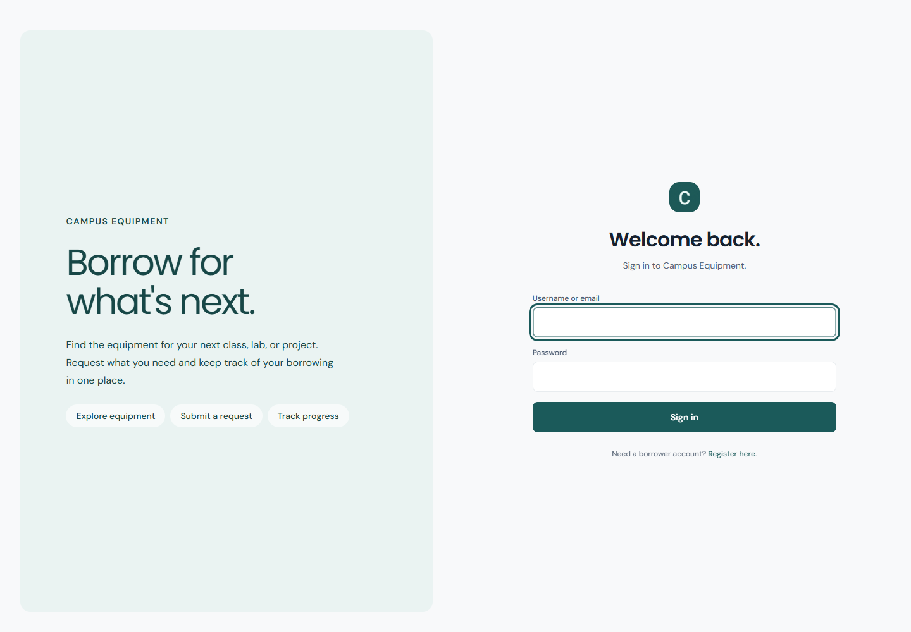

*The same sign-in page serves both roles. You do not choose your role on this form.*

Use your own account or the demonstration credentials supplied privately by the coordinator. If your account has been
deactivated, ask an administrator about reactivation. Do not share passwords in screenshots or problem reports.

### Find your way around and sign out

The main navigation contains your role's work areas. On a narrow screen, scroll the navigation to reach further items;
wide tables may also scroll horizontally. Select your name/avatar in the workspace bar to open your profile.

Use **Log out** when finished, especially on a shared computer. Signing out ends your session; closing a tab alone is
not the sign-out action. You can use Tab/Shift+Tab to move between controls and **Skip to content** to reach the page body.

## Basic-user guide

### Create a borrower account

1. On the sign-in page, select **Register here**.
2. Enter a unique username, first name, last name and email address. Contact number is optional.
3. Enter a password and repeat it in **Confirm password**. Follow any password-validation messages.
4. Select **Create account**. After the success message, sign in with the new account.

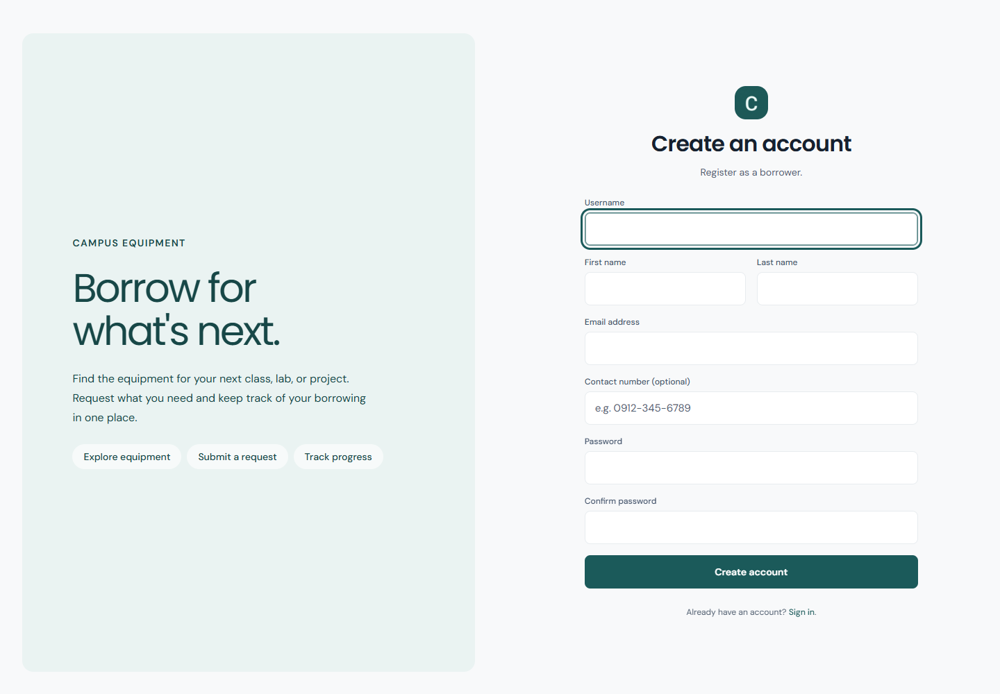

*Registration creates a basic-user account. Administrator access is arranged by the project coordinator.*

If the username/email is already used, choose your own unused details. If the two passwords differ, enter matching values.

### Use Home

Home summarizes your Pending requests, Approved requests, Active loans and Overdue loans. **Create a request** opens
the borrowing form. The recent-request and equipment-to-return previews show a limited selection; use **My requests**
or **My loans** for the full lists.

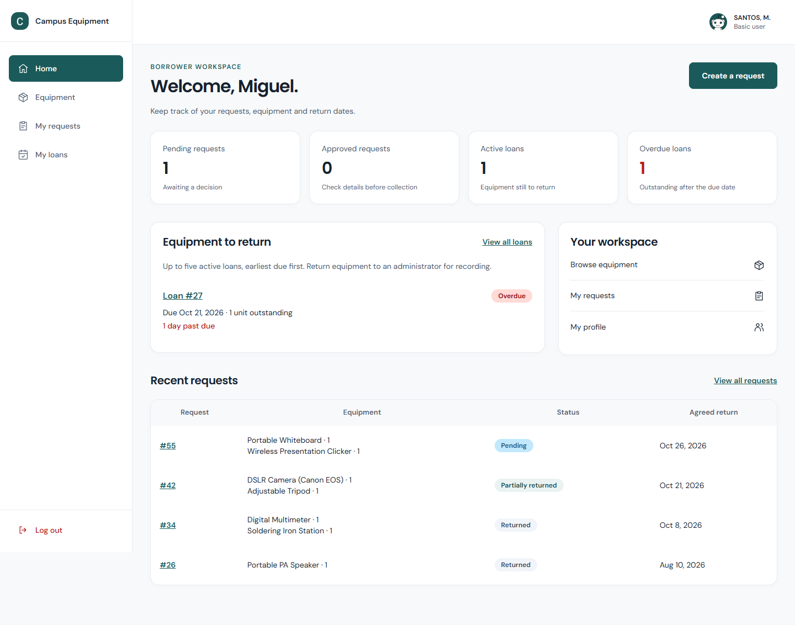

*An approved request is ready for the administrator's release process. An active loan means equipment is still to return.*

### Find available equipment

1. Open **Equipment**.
2. Enter an equipment name in **Search equipment**, choose a category if needed, and select **Search**.
3. Select **View details** for an item to read its description and quantities.
4. Use **Clear filters** to return to the unfiltered list.

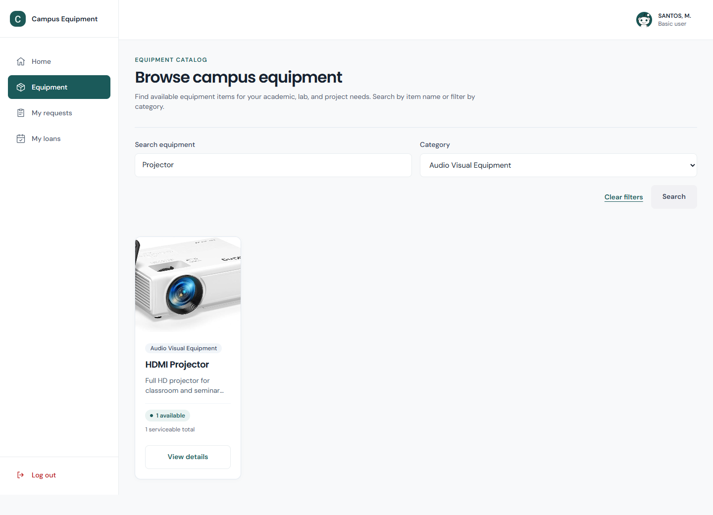

*Available quantity is stock currently ready for reservation. Serviceable total also includes reserved and issued units,
so it may be larger than the available quantity.*

Availability may change while another request is being processed. Browsing or submitting a request does not reserve
equipment. Archived items/categories are not offered for new requests. A placeholder image may appear if a photo is absent.

### Submit a borrowing request

1. From **Home**, select **Create a request**.
2. Enter a clear **Purpose**, such as the class activity or project that needs the equipment. Avoid unnecessary personal
   or confidential information.
3. Choose the **Desired return date** using the date control.
4. Choose one to three **different** equipment items and enter a positive whole-number quantity for each. Leave unused
   rows blank; do not list the same item twice.
5. Review the form and select **Submit request**.
6. Check the resulting request detail and its **Pending** status under **My requests**.

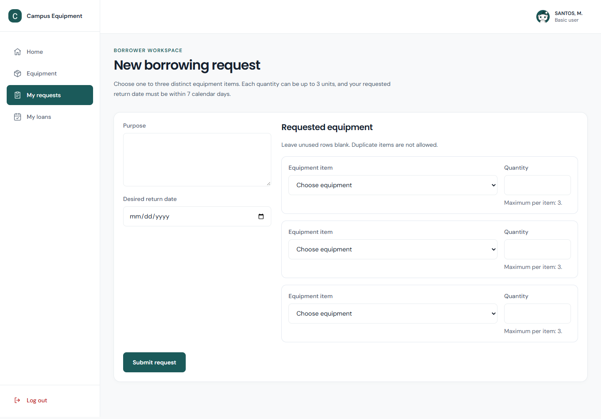

*Use the limits displayed on your form. Initial settings allow up to three units per item and seven calendar days;
an administrator may change the limits for newly submitted requests.*

The return date must be after the submission date and within the displayed duration, using Asia/Manila calendar dates.
For example, if the form currently allows seven days, tomorrow through seven days after submission are within that
window. The system checks every row before saving the request. Correct highlighted fields and submit again if validation
fails; check **My requests** before starting another request if you are unsure whether the first submission succeeded.

Submitting creates a request for review. The administrator must approve it and later record the equipment release.

### Follow your requests and loans

1. Open **My requests** and use the status filter to find a request. Select its number to read its purpose, items,
   decision information and agreed due date.
2. After approval, check the reserved units and coordinate collection with the administrator.
3. After release, open **My loans**, then the loan number. Review the due date, issued units and returned/outstanding
   quantities. Return the listed physical equipment to an administrator for recording.

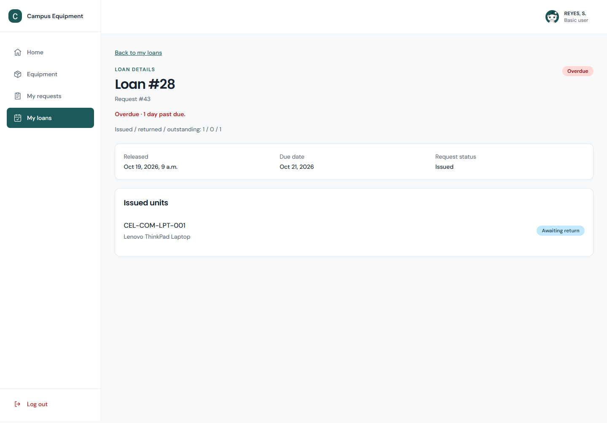

*The loan detail identifies the equipment still outstanding. Its example dates are from the screenshot capture.*

An outstanding loan becomes overdue after its due date; it is not overdue on the due date itself. Returning some units
leaves the rest outstanding. The loan closes only after an administrator records every issued unit as returned.
Basic users cannot record their own returns, approve/release equipment or revise due dates.

### Cancel a request before release

1. Open the request from **My requests**.
2. If its status is **Pending** or **Approved**, select its cancellation action.
3. Check the request number and confirmation message.
4. Select **Confirm cancellation** to proceed, or **Keep request** to leave it unchanged.

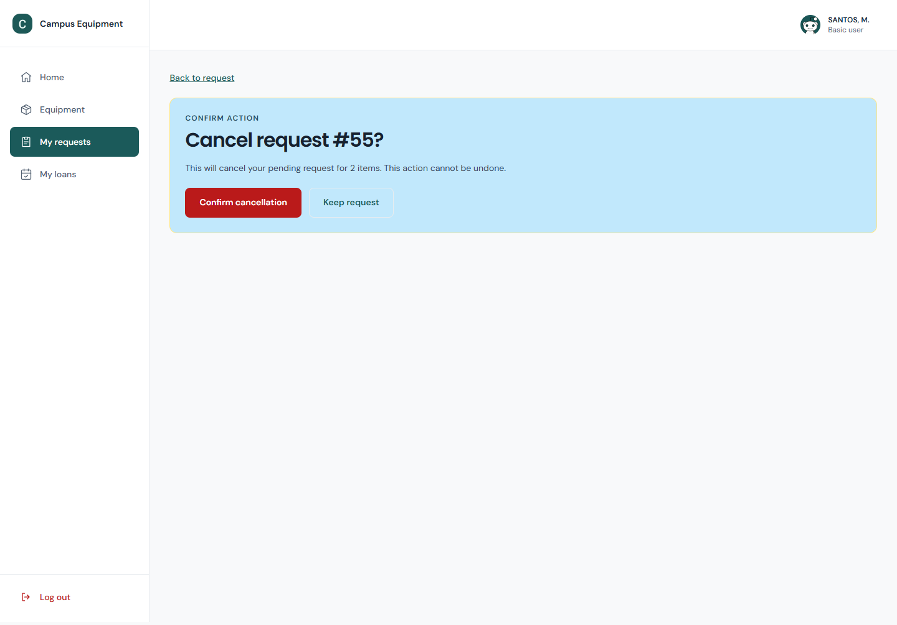

*Cancellation cannot be undone. Cancelling an Approved request releases its reserved units.*

Issued, partially returned, returned, rejected and already cancelled requests cannot be cancelled through this action.
Submitted items/quantities cannot be edited in place; for an eligible request, cancel it and submit a corrected request.

### Update your profile

1. Select your name/avatar in the workspace bar, or **My profile** from Home.
2. Update your first name, last name, email address or optional contact number.
3. Select **Save changes** and check the confirmation.

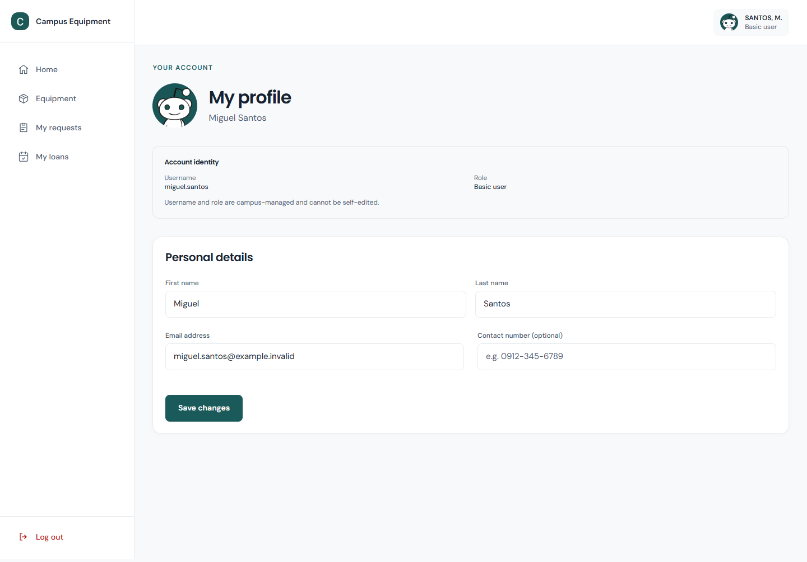

*Username, role and activation status cannot be self-edited. Profile images and passwords are not editable on this form.*

## Administrator guide

### Read the Dashboard

After sign-in, the Dashboard shows four current counts: **Available units**, **Pending requests**, **Active loans** and
**Overdue loans**. Use the card links or navigation to open the related records. Refresh/reopen the page to see changes
made since it loaded.

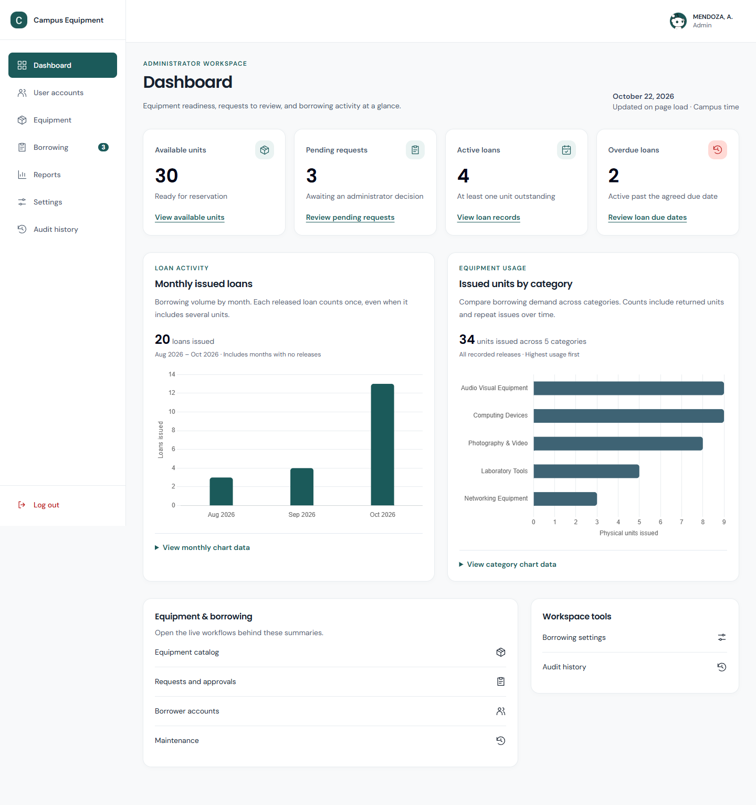

*Available units are a subset of inventory; Active loans are a subset of all loan history. These cards are not total
catalog or historical-loan counts.*

The monthly chart counts issued loans. The category chart counts issued physical units, including units later returned
and repeat issues over time. Open **View monthly chart data** or **View category chart data** for the table alternatives.
Select your name/avatar for your administrator profile; that profile is a read-only account summary.

### Manage basic-user access

1. Open **User accounts**. Search by username, name, email or contact number and use the status filter as needed.
2. Open the intended account and verify its identity. The detail page includes request and borrowing history.
3. Choose **Deactivate account** for an active account or **Activate account** for an inactive account.
4. Review the confirmation page and confirm only the intended change. Check the resulting account status.

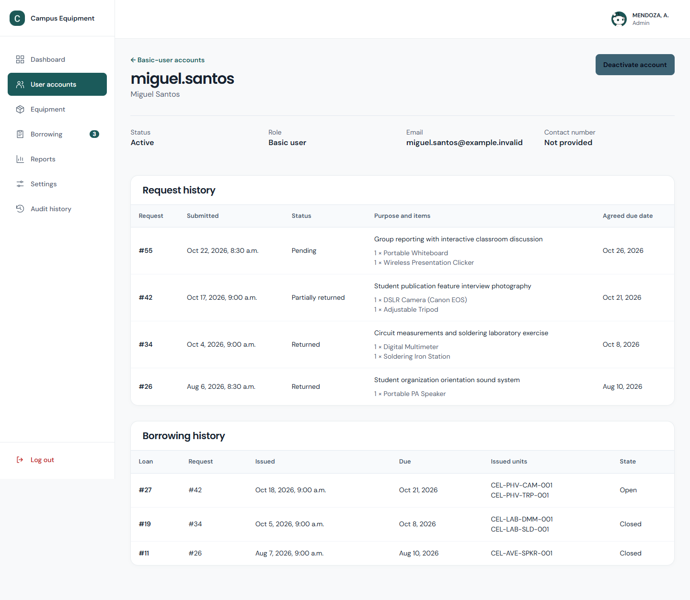

*Deactivation preserves history. It blocks sign-in and protected operations, including use through an existing session.*

This area manages basic-user activation; it is not a role-promotion or administrator-account creation screen. Deactivation
does not cancel requests, erase a loan or record an equipment return. Continue receiving issued equipment through the
normal return workflow even if its borrower is now inactive.

### Organize categories and catalog items

**Categories:** open **Equipment → Categories**. Create a category with its name and optional description; open an
existing category to edit it or inspect its items. Category names must be unique, including differences in letter case.

**Catalog items:** open **Equipment → Catalog items**. Create an item under an active category, with a name and
borrower-facing description. An equipment item describes a type of equipment; individual pieces are registered separately
as physical units. Open an item to edit its permitted details, manage its photo and inspect counts/units.

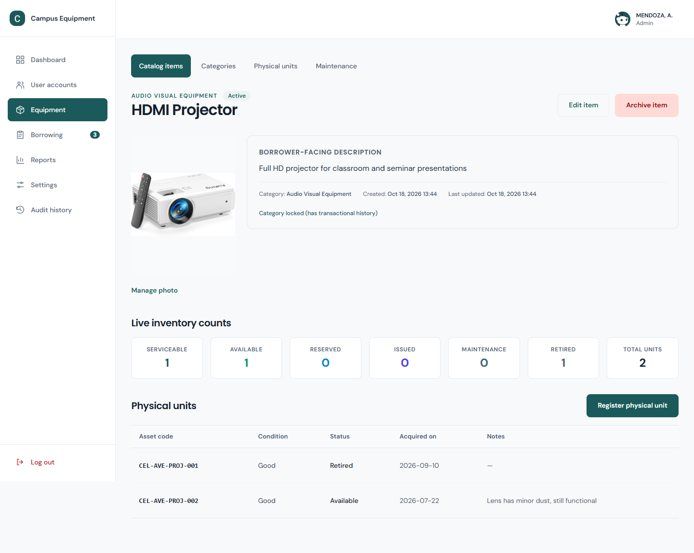

*One catalog item may have several physical units, each with its own asset code and status.*

For photos, use the optional creation upload or **Manage photo** on the item detail. The photo page provides upload/
replacement and removal actions. Use a still JPEG, PNG or WebP of at most 5 MB and 20 million pixels. Check the preview
and result; use only appropriately sourced equipment imagery without personal/confidential content. Removing a photo
returns the item to its placeholder image and does not delete the catalog record.

To stop offering a category/item, open its **Archive** action and confirm. Archival preserves history and blocks new
requests/approvals for the affected items; existing reservations, releases, returns and maintenance still require handling.
Use the archived/status filter to find an archived record and its **Restore** action. Restoring a category does not restore
individually archived items; an item under an archived category remains unavailable to new requests until both are active.
Archiving/restoring does not change physical-unit statuses. Some category/item relationships lock once history exists.

Additional illustrations: [category creation](../screenshots/51-admin-category-create.png),
[item creation](../screenshots/54-admin-item-create.png) and [archived catalog](../screenshots/06-admin-catalog-archived.png).

### Register and inspect physical units

1. Open **Equipment → Physical units** and choose **Register physical unit**, or use that action from an item detail.
2. Select the active equipment item, enter a unique **Asset code**, choose the **Initial condition** and provide the
   **Acquisition date**. The acquisition date cannot be in the future.
3. If the condition is **Damaged**, describe the **Initial maintenance problem**. Internal notes are optional and visible
   only to administrators.
4. Select **Register physical unit** and check the resulting unit detail/status.

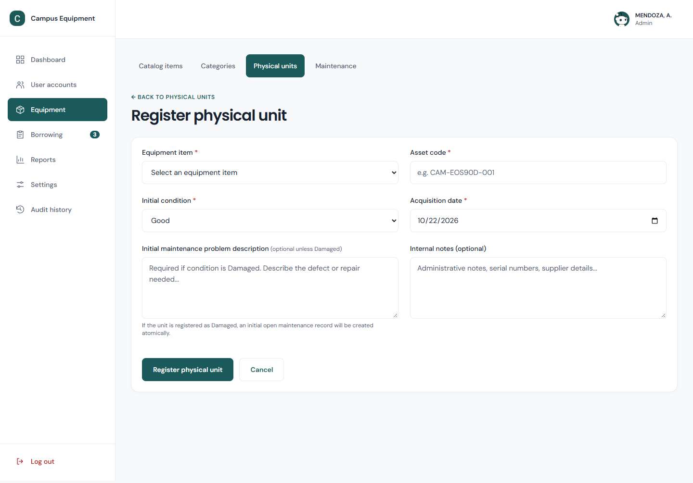

*Good/Fair units begin Available. A Damaged unit begins in Maintenance with an open maintenance record.*

Use the units list's search/category/item/status filters to locate equipment. Asset codes must be unique regardless of
letter case. The item detail reconciles Available + Reserved + Issued + Maintenance + Retired to total physical units.

Use the unit's edit page only for permitted corrections. Once borrowing or maintenance history exists, its asset code,
item and acquisition date lock; only internal notes remain editable. Generic editing does not change condition/status.
Use approval/release, returns and maintenance to record those changes. A retired unit cannot be reactivated through editing.

### Review and approve or reject requests

1. Open **Borrowing** and find the request using its ID/borrower, status and submission-date filters.
2. Open the Pending request. Read the borrower, purpose, items, quantities, due date and current availability.
3. Select **Approve** or **Reject**.
4. Enter a clear **Reason**, within the form's 500-character limit. Avoid unrelated personal information.
5. Confirm the decision, or use **Keep request unchanged** to return without deciding.

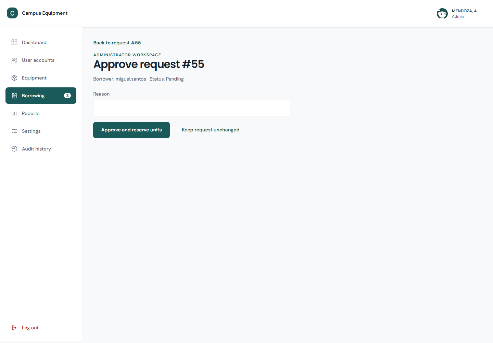

*Approval reserves specific available units for every requested quantity. It does not hand over equipment or create an
issued loan. Check the approved request's assigned asset codes after success.*

Approval succeeds for the whole request or leaves it unchanged. If stock becomes insufficient, a borrower becomes
inactive or another administrator has already decided the request, read the conflict message and reopen the current
record. Do not assume the earlier availability display still applies. Rejection stores the reason and reserves no units.

### Revise an agreed due date before release

1. Open the **Approved** request and select **Revise due date**.
2. Enter the new **Agreed due date** and a clear **Reason**, then submit the revision.
3. Check the updated agreed date before releasing equipment.

The date must differ from the current agreed date, be after submission, be on/after today's campus date and remain
within the duration limit saved when the request was submitted. Changing global settings does not enlarge that saved
window. If no valid date remains, the borrower must cancel the eligible request and submit a new one. There is no
post-issue due-date extension action. See the [revision-form example](../screenshots/63-admin-due-date-revision.png).

### Release equipment and print a borrowing slip

1. Open the Approved request and select **Release equipment**.
2. Match the borrower and every reserved asset code to the equipment being handed over. Release covers the complete
   reservation; the page is not a partial-release form.
3. Check that the agreed due date is today or later and that the borrower is active.
4. Select **Confirm release** only when handing over those units. **Cancel** returns without releasing.
5. On the resulting loan detail, open the borrowing slip and use its **Print** button for the browser's print dialog.

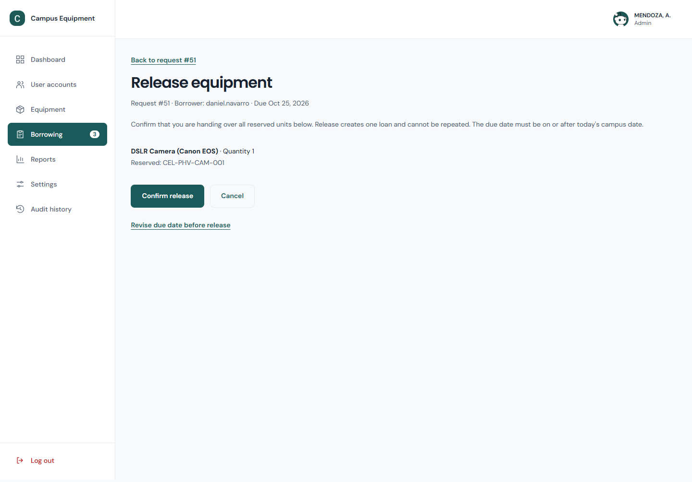

*Release creates one loan and marks its units Issued. It cannot be repeated for the same request.*

Use the [borrowing-slip example](../screenshots/20-admin-borrowing-slip.png) to recognize the print view. Verify the loan
number, borrower, asset codes and due date before printing. A passed due date or inconsistent reservation must be
resolved through the displayed workflow, rather than bypassed by repeatedly confirming.

### Record partial, complete or damaged returns

1. Open **Borrowing**, follow **Issued loans**, find the loan and open its detail. A linked loan from its request also
   leads to the detail. Select **Return units** while units remain outstanding.
2. For each piece physically received, tick **Return this unit**, verify **Issued unit**, and select **Returned condition**:
   Good, Fair or Damaged. Leave equipment not received unselected.
3. Add optional admin-only return notes. For every Damaged unit, enter its **Maintenance problem**.
4. Recheck the selected asset codes and conditions. Select **Confirm selected returns**, or **Cancel** to leave unchanged.
5. Check the loan's returned/outstanding counts and the recorded unit outcomes.

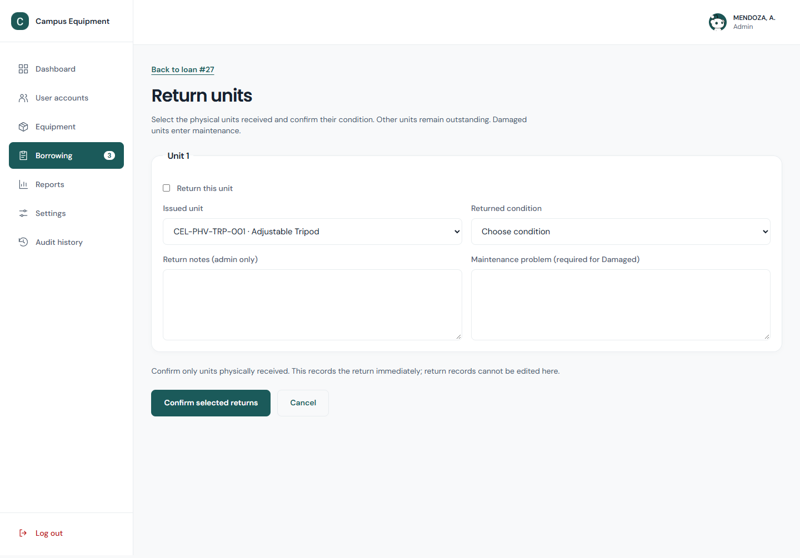

*Confirm only equipment actually received. Recorded returns cannot be edited on this page or repeated for the same unit.*

Good/Fair returns become Available. A Damaged return opens linked maintenance and keeps the unit unavailable.
Returning some units produces **Partially returned** and leaves the loan active; returning all closes it. Follow the
linked maintenance record to repair or retire damaged equipment. The administrator can receive issued equipment even
when the borrower is inactive or its catalog item has been archived.

### Open and close equipment maintenance

**Open maintenance:** go to **Equipment → Maintenance**, choose **Open maintenance**, select an eligible available
physical unit and describe its problem. Confirm opening and check the record. Reserved, Issued, Retired and already-in-
maintenance units are ineligible. For damaged returns or newly registered damaged units, use the already-created record
instead of opening a duplicate. See the [opening-form example](../screenshots/59-admin-maintenance-create.png).

**Close maintenance:**

1. Open the unit's Open maintenance record and select **Close maintenance**.
2. Describe the **Action taken / Resolution**.
3. Choose **Maintenance outcome**: Available after repair, or Retired when the unit is permanently unavailable.
4. For Available, select the repaired condition, Good or Fair.
5. Select **Complete & close maintenance** and check the closed record and physical-unit status.

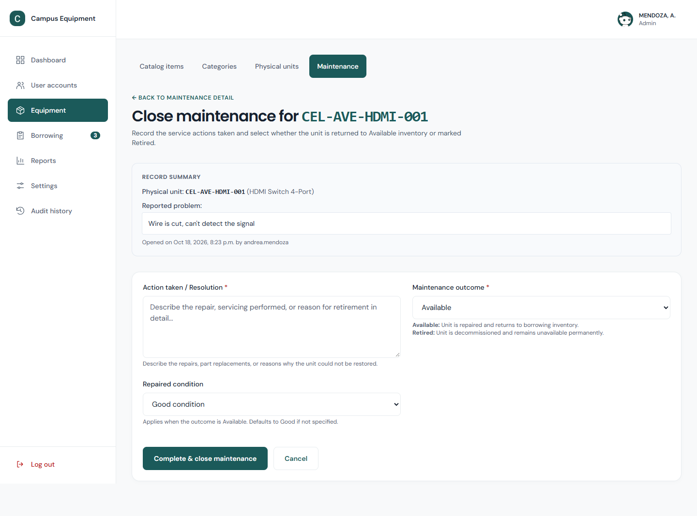

*Closing to Available makes a repaired unit borrowable again. Retired units remain unavailable; a closed record cannot
be closed a second time.*

The maintenance list filters Open/Closed records. Retain the recorded problem, action, dates and responsible accounts
for history; do not try to repair inventory counts by changing a unit's generic edit form.

### View reports and download CSV

1. Open **Reports** for the loan report. Use **View overdue report** when checking outstanding overdue loans.
2. Optionally set **Issue date from** and **Issue date through**, then select **Filter report**. The bounds include loans
   issued on the selected dates; they filter issue dates, not due dates or return dates.
3. Review the loan count and issued/returned/outstanding unit totals. Use paging and horizontal scrolling as needed.
4. Select **Download CSV** to export all matching rows with the current filters, including rows beyond the current page.
5. Use **Clear filters** to remove the date range. Correct a reversed/invalid range before downloading.

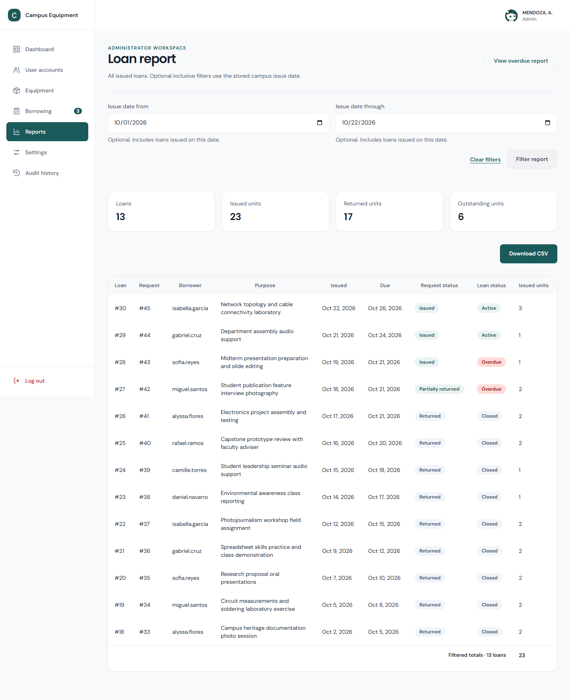

*The overdue report includes only loans with outstanding units after their due dates. Returning the final unit removes
the loan from current overdue results while preserving its history.*

Keep exported reports within the approved audience. A download contains borrower/transaction information and should
not be posted publicly. The browser's download location depends on its own settings.

### Change borrowing limits

1. Open **Settings**.
2. Enter positive whole numbers for **Maximum loan duration (calendar days)** and **Maximum quantity per request item**.
3. Select **Save settings** and check the resulting values and last-updated information.

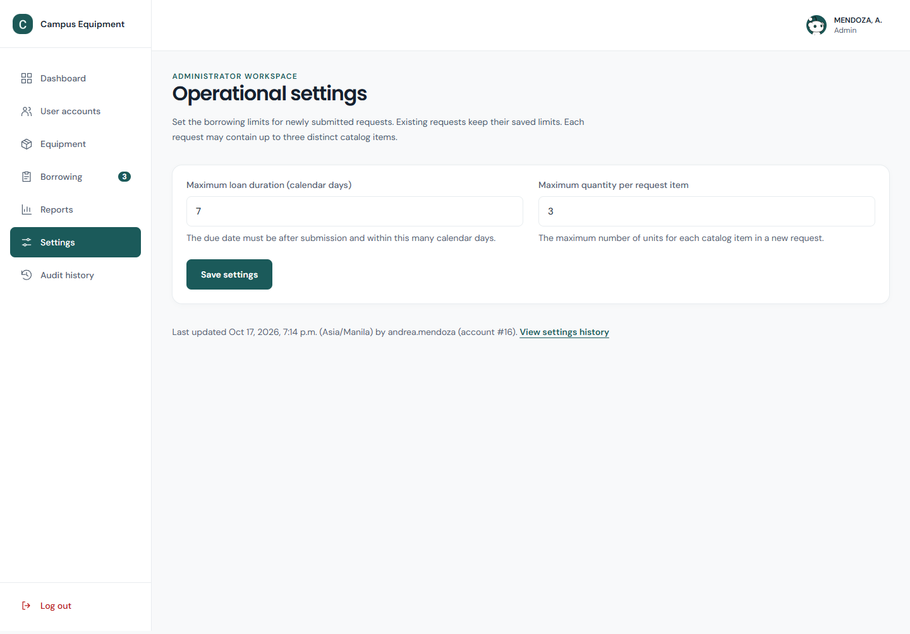

*Settings apply to newly submitted requests. Existing requests keep their saved limits; the one-to-three-distinct-item
rule is separate from the quantity limit for each item.*

### Read audit history

1. Open **Audit history**.
2. Filter by **Record reference**, **Action**, **Actor account ID** or the **Occurred from/through** date range.
3. Select **Search history** and review the actor, action, timestamp, record reference and summary.
4. Use **Clear filters** or paging to inspect other entries.

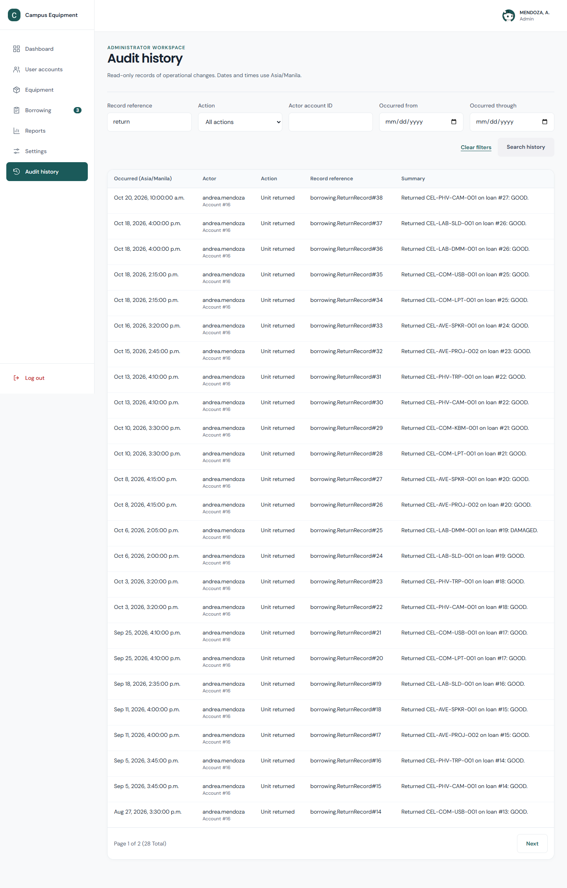

*Audit history is read-only and uses Asia/Manila timestamps. It is not an edit/delete interface for previous actions.*

## Understanding statuses

### Request and loan statuses

| Label | Meaning and next step |
| --- | --- |
| Pending | Submitted; awaiting an administrator's decision. The borrower may cancel. No units are reserved yet. |
| Approved | All quantities reserved; awaiting release. The borrower may cancel before issue. |
| Rejected | Administrator declined the request; read its reason. Submit a new request if appropriate. |
| Cancelled | Borrower cancelled before issue. Any reservation was released. Submit a new request if needed. |
| Issued | Administrator released equipment; a loan exists and units remain outstanding. |
| Partially returned | Some issued units were recorded as returned; the remaining units are still due. |
| Returned / Closed | Every issued unit was recorded as returned; the loan is complete. |
| Active / Open loan | At least one issued unit remains outstanding, including partially returned loans. |
| Overdue | An outstanding loan is past its due date. This label is calculated; it is not a manually chosen request state. |

### Physical-unit statuses

| Label | Meaning |
| --- | --- |
| Available | Ready for an eligible request's reservation. |
| Reserved | Assigned to an Approved request before handover. |
| Issued | Released on a loan and not yet returned. |
| Maintenance | Unavailable while its open maintenance record is handled. |
| Retired | Permanently unavailable through the current application workflow. |

## Common problems

| What you see | What to do |
| --- | --- |
| Invalid username/email or password | Check your own credentials and sign-in spelling; contact the coordinator if access help is needed. This interface has no self-service password-reset screen. |
| Account deactivated | Ask an administrator about the account's status. Registering another account is not a reactivation action. |
| Empty equipment/request/report list | Use Clear filters, check the selected status/date/category and paging, and verify that you are in the intended account. |
| Invalid quantity or return date | Use distinct items, whole-number quantities within the displayed per-item limit, and a date after submission within the displayed calendar-day window. |
| Duplicate username/email or asset code | Check the existing record and use the correct unique identity; letter case alone may not make it distinct. |
| Approval/release/return conflict | Reopen the record to see its current state. Check availability, eligibility and existing results before repeating an action. |
| No cancellation/release/return action | The record may be at an ineligible or completed stage. Use the status table; do not expect every action in every state. |
| Page not found or access denied | Return through your role's navigation and confirm the record belongs to your account where required. Ask the administrator about an unexpected denial; do not guess other users' record URLs. |
| Session or form-expiry message | Sign in again if needed, reopen the current page, check whether the action already succeeded and use a fresh form. |
| Photo upload rejected | Use a still JPEG/PNG/WebP within the displayed size/pixel limits and read the specific upload error. |
| Photo placeholder | Item details still work without a photo. Ask the administrator to check the image if it should be present. |
| Technical error or unavailable site | Record the page, time, request/loan/asset reference and error message; contact the coordinator. Never include passwords or private connection details. |

## Help and guide edition

For borrowing/account questions, contact the equipment administrator through your team's agreed channel. For setup,
backups, recovery or application maintenance, the coordinator/technical maintainer uses [README setup](../README.md#run-locally)
and [DEV](../DEV.md); those tasks are separate from equipment repair in the administrator guide.

Guide reviewed against application source and the existing screenshots on **October 23, 2026, Asia/Manila**. Instructions
describe the implemented forms, labels and workflow restrictions. The [authoring handoff](../handoffs/t29-combined-user-manual-with-screenshots-10-23-2026.md)
records source checks, evidence limits and remaining T29 validation. A fresh user walkthrough of this edition is pending;
the presence of a screenshot does not establish execution of every action described above.
